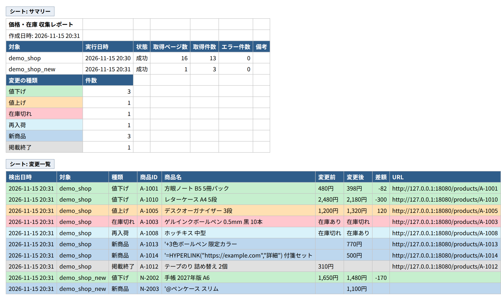
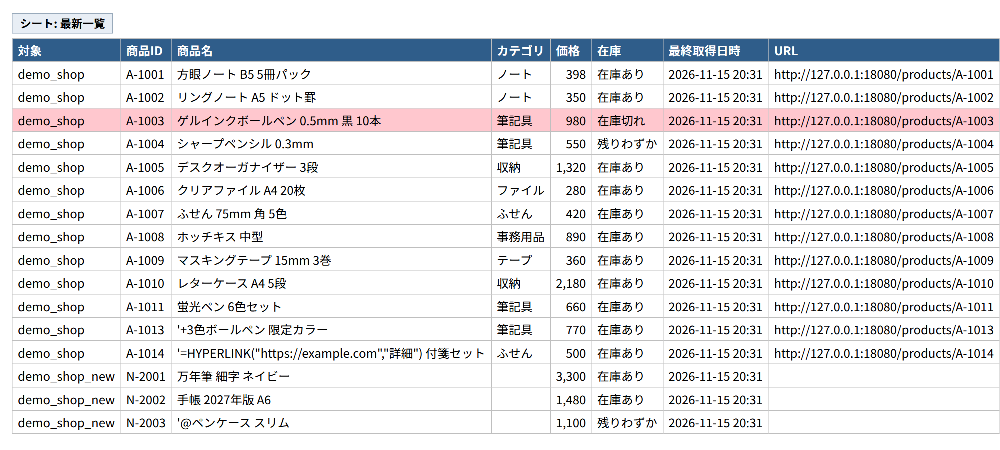
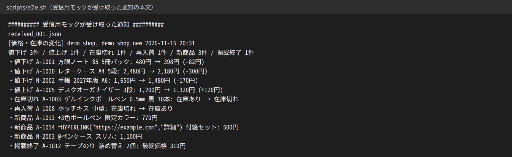
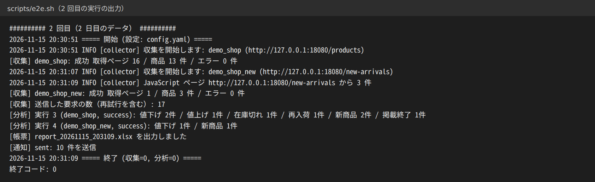
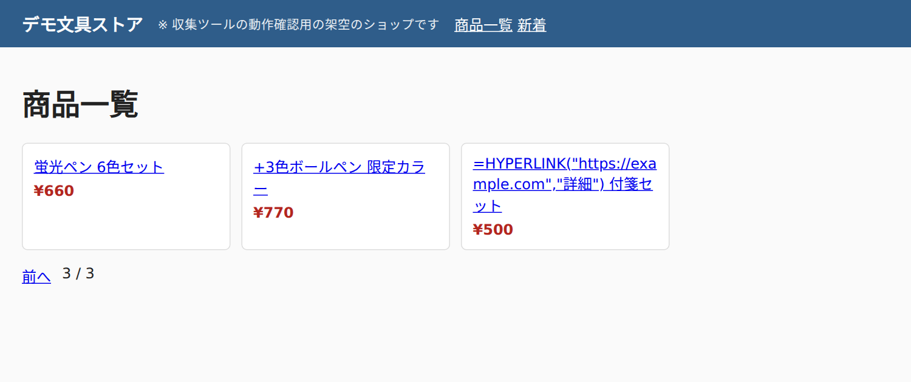
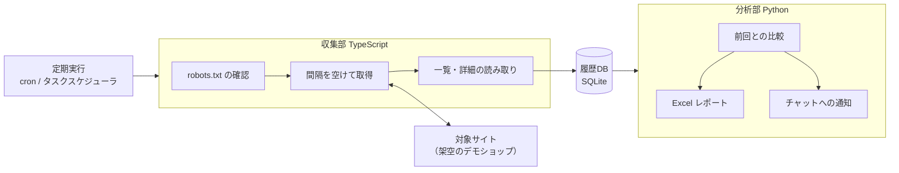

# Webデータ収集・定期レポートツール

[](https://github.com/takato-y/web-data-collector/actions/workflows/test.yml)

- GitHub Actions で検査している範囲：分析部の自動テスト（pytest）と収集部の自動テスト（node --test）。ブラウザを使うテストはブラウザが無いと飛ばす
- 手元の環境でのみ確かめた範囲：架空のデモショップを使う通し試験（scripts/e2e.sh）、ブラウザを使うテスト、手動の確認（再試行の回復・run.ps1）

Web ショップに掲載されている商品の価格と在庫を決まった時刻に自動で集め、前回からの変化（値下げ・在庫切れ・新商品など）を Excel のレポートとチャットへの通知でお知らせするツールです。

本リポジトリはポートフォリオ（閲覧用）です。無断での再利用・再配布はご遠慮ください。

## 何の業務がどう楽になるか

想定する業務は、仕入先や競合の Web ショップの価格・在庫を毎日確認する作業です。

| これまで | 導入後 |
|---|---|
| 担当者が毎朝、数十件の商品ページを 1 件ずつ開き、価格と在庫を Excel に書き写す | 決まった時刻に自動で集める。担当者が開く必要はない |
| 前日の表と目で見比べて値下げや在庫切れを探すため、見落としが起きる | 前回との違いを自動で判定し、「値下げ」「在庫切れ」などの種類ごとに色分けした一覧を作る |
| 表を上書きしてしまい、価格がいつ変わったか後から追えない | 毎回の値を履歴として残し、価格の推移のグラフを帳票に含める |
| 変化に気付いた担当者が、チャットに手で書き込んで共有する | 変化があったときだけ、チャットツールに要点を自動で投稿する |

## 概要

- 収集の対象は、本リポジトリに含まれる**架空のデモショップ**（手元のパソコンの中だけで動く練習用の Web ショップ）です。実在のサイトからは収集していません
- 収集は TypeScript（Node.js）、分析・帳票・通知は Python で作り、両者は SQLite（1 ファイルで動くデータベース）を介して受け渡します
- 対象サイトに負担をかけないこと、サイトの取り決め（robots.txt）を守ることを最優先にしています（「利用上の注意」を参照）

## できること

| できること | 内容 |
|---|---|
| 一覧と詳細の収集 | 複数ページにわたる商品一覧をたどり、各商品の詳細ページから在庫やカテゴリを補います |
| JavaScript で表示されるページの収集 | ページを開いた後にプログラムで商品が描かれるページも、ブラウザを自動で動かす部品（Playwright）で読み取ります |
| 取り決めの順守 | 収集の前に robots.txt（サイトが自動収集の可否を示すファイル）を確認し、禁止されたページは取得しません |
| 負荷の抑制 | 同じサイトへのアクセスは既定で 1 秒に 1 回以下。サイトが待ち時間を指定していればそれに従います |
| 失敗への備え | 相手が混み合っているときは間隔を広げて再試行し、応答のない通信は一定時間で打ち切ります |
| 変化の検出 | 値下げ・値上げ・在庫切れ・再入荷・新商品・掲載終了の 6 種類を判定します |
| Excel レポート | サマリー、種類ごとに色分けした変更一覧、最新一覧、価格推移のグラフを 1 つのファイルにまとめます |
| チャットへの通知 | Webhook（決まった URL に送るだけで投稿できる仕組み）で、Slack・Teams・Discord に合わせた形式の通知を送ります |
| 定期実行 | Linux の cron、Windows のタスクスケジューラから 1 コマンドで動かせます（Windows 用スクリプトは構文確認のみ） |

## 出力例

いずれも、架空のデモショップを対象に通し試験（`scripts/e2e.sh`）を実行したときの実際の出力です。

**Excel レポート（サマリー・変更一覧）**



2 回目の収集で検出した 10 件の変更です。種類ごとに行の色を変えています。商品名が `=` `+` `@` で始まるもの（デモデータに意図的に入れた試験用の商品名）は、Excel で数式として実行されないよう先頭に `'` が付いています。
画像は、出力した xlsx のセルの値と色を読み出して表に写し、ブラウザで描画したものです（Excel の画面そのものではありません）。

**Excel レポート（最新一覧）**



掲載中の商品の最新の価格と在庫です。在庫切れの行は赤で示します。画像の作り方は上と同じです。

**チャットへの通知（手元の受信用モックが受け取った本文）**



実在のチャットサービスには送らず、手元で動く受信用のモック（受け取った内容を保存するだけの仕組み）に送って確認しています。

**実行時の画面（2 回目の実行）**



**収集の対象にした架空のデモショップ**



## 構成



| 技術 | 役割 | 主なファイル |
|---|---|---|
| TypeScript / Node.js | 収集部。HTTP の取得（標準の fetch）、HTML の読み取り（cheerio）、robots.txt の解釈（robots-parser）、履歴DB への書き込み（better-sqlite3） | `collector/src/` |
| Playwright | JavaScript で表示されるページの取得（任意。ブラウザ本体も `collector/node_modules` の中に入れます） | `collector/src/jsRenderer.ts` |
| Python | 分析部。差分検出、Excel レポート（openpyxl）、Webhook 通知 | `webcollector/` |
| SQLite | 収集部と分析部の受け渡し口。定義は 1 か所にまとめ、両方が同じ定義を使います | `sql/schema.sql` |
| シェル / PowerShell | 収集部 → 分析部を順に実行する定期実行用のスクリプト（PowerShell 版は ASCII 文字のみで記述） | `scripts/run.sh`、`scripts/run.ps1` |
| Flask | 架空のデモショップ（127.0.0.1 でのみ待ち受け） | `demo_site/` |
| node:test / pytest | 収集部と分析部の自動テスト | `collector/test/`、`tests/` |

収集を TypeScript、分析を Python に分けた理由は [ADR-0004](docs/adr/0004-言語の分担.md) と [基本設計書 2 章](docs/02_基本設計.md) にまとめています。

### 設計書

| 文書 | 内容 |
|---|---|
| [01_要件定義.md](docs/01_要件定義.md) | 背景・課題、要件（REQ）、非機能要件（負荷・法令と規約の順守・障害時の扱い）、対象外 |
| [02_基本設計.md](docs/02_基本設計.md) | 構成図、方式設計（言語の分担・受け渡し口）、機能一覧（FN）、帳票と通知のレイアウト |
| [03_詳細設計.md](docs/03_詳細設計.md) | 収集・差分検出・通知のフロー、例外表とエラー一覧（ERR）、ログ方針 |
| [04_テーブル定義書.md](docs/04_テーブル定義書.md) | 履歴DB の DDL、ER 図、列ごとの書き込み担当 |
| [05_テスト仕様書.md](docs/05_テスト仕様書.md) | テストケース（TC）と実施結果、通し試験の出力 |
| [06_導入・運用手順.md](docs/06_導入・運用手順.md) | 収集前の確認事項、導入、定期実行の登録、困ったとき、定期点検・バックアップ・資格情報の更新・連絡体制 |
| [07_障害対応手順書.md](docs/07_障害対応手順書.md) | 障害時の切り分け、エラーID（ERR）ごとの対処と再実行の可否、robots.txt を守る方針、記録と報告 |
| [docs/adr/](docs/adr/) | 設計判断の記録（収集方式・履歴の保存方式・対象サイトへの配慮・言語の分担・robots.txt の 4xx と商品 0 件の扱い） |
| [CHANGELOG.md](CHANGELOG.md) | 変更履歴 |

### 要件 → 機能 → テストの対応（抜粋）

| 要件 | 機能 | 主なテスト |
|---|---|---|
| REQ-004 robots.txt の順守 | FN-002 | TC-002-01〜07 |
| REQ-005 アクセスの間隔 | FN-002, FN-003 | TC-003-01〜02、TC-E2E-01（実測の間隔） |
| REQ-006 再試行・タイムアウト | FN-004 | TC-004-02〜07、TC-E2E-02 |
| REQ-008 変化の検出 | FN-008 | TC-008-01〜13 |
| REQ-009 Excel レポート | FN-009 | TC-009-03〜07 |
| REQ-010 チャットへの通知 | FN-010 | TC-010-01〜11 |
| REQ-013 数式・呼び出しの無害化 | FN-009, FN-010 | TC-009-01・05、TC-010-01・02 |

全件は [05_テスト仕様書.md](docs/05_テスト仕様書.md) を参照してください。

## 使い方

必要なもの: Node.js 22 以上、Python 3.12 以上。

```bash
# 準備
python3 -m venv .venv && .venv/bin/pip install -r requirements-dev.txt
(cd collector && npm ci && npm run build && npm run install-browser)

# 自動テスト
(cd collector && npm test)
.venv/bin/python -m pytest

# デモショップを相手に、収集 → データの差し替え → 収集 → レポート → 通知 を一通り実行
scripts/e2e.sh
```

自分の対象サイトで使う手順（設定ファイルの書き方、Webhook の URL の渡し方、定期実行の登録）は [06_導入・運用手順.md](docs/06_導入・運用手順.md) に、終了コードが 0 以外のときや通知が届かないときの対応は [07_障害対応手順書.md](docs/07_障害対応手順書.md) にまとめています。

## 利用上の注意

- **収集前に、対象サイトの利用規約と robots.txt を必ず確認してください。** 自動的な収集を禁止しているサイト、公式の API やデータ提供があるサイトでは、このツールを使わないでください
- ログインが必要なページ、個人情報を含むページは収集の対象にしないでください
- アクセスの間隔を短くしすぎないでください（設定の下限は 0.5 秒、既定は 1 秒）。収集の頻度は必要最小限（1 日数回程度）にしてください
- 通信時の名乗り（User-Agent）には、ツール名と問い合わせ先のページを入れてください（`config.example.yaml` の `user_agent`。`example.com` の部分は利用者の問い合わせ先に置き換えます）。対象サイトから停止の依頼があった場合は、ただちに収集をやめてください
- 収集した値は社内での確認に使い、再配布・公開はしないでください
- Webhook の URL は環境変数で渡し、設定ファイルやリポジトリに書かないでください（設定ファイルに書くと読み込み時に止まるようにしています）

## 工夫した点

- **誤った通知を出さない判定**: 一部のページが取得できなかった回は「掲載終了」を判定しない、初回は「全商品が新商品」にしない、取れなかった値は比較しない、といった決まりで、取得の失敗を商品の変化と取り違えないようにしました
- **対象サイトへの配慮を仕組みにしたこと**: robots.txt が一時的に読めないときはそのサイトを見送る、相手が指定した待ち時間に従う、同じページを 2 回取らない、他のサイトへのリンクをたどらない、ブラウザ使用時も画像などの不要な読み込みを止める、といった配慮をコードで強制しています
- **Web 由来の文字列の無害化**: 商品名は外部のサイトが自由に書ける値です。Excel で数式として実行されないよう `=` `+` `-` `@` などで始まる値の先頭に `'` を付け、チャットでは全員宛ての呼び出しが起きないようにしました。URL もリンクにはせず文字列で載せています
- **言語ごとの得意分野で分け、受け渡し口を文書化**: 収集は Web 向けの部品が充実した TypeScript、帳票は Excel を細かく作れる Python で作り、両者の受け渡しは SQLite のテーブル定義だけにしました。列ごとに書き込む側を 1 つに決め、テーブル定義書に明記しています
- **通知の取りこぼし防止**: 送信に失敗した変化は「未通知」のまま残し、次の実行でまとめて送ります
- **実在のサイトに触れずに試験**: 架空のデモショップ（ページ送り・詳細・robots.txt・JavaScript で描くページ・混雑の再現つき）と受信用モックを用意し、すべて手元のパソコンの中で試験しました

## 確認していないこと

- Windows のタスクスケジューラからの実行、`scripts/run.ps1` の実行（Windows PowerShell 5.1 で構文に誤りが無いことだけを確認）
- cron への登録と、決まった時刻での起動（起動されるスクリプトそのものは通し試験で実行）
- Slack・Teams・Discord の実際のサービスへの送信（各形式の JSON を組み立てるところまでを試験。受け口の仕様は導入時に確認が必要）
- Excel などの表計算ソフトで帳票を開いたときの見た目と、価格推移グラフの描画（セルの値・色・数式でないことと、グラフの定義が含まれることは自動テストで確認）
- 実在の Web サイトからの収集、長期間の運用、macOS での動作

## 動作環境

| 項目 | 確認した環境 |
|---|---|
| OS | Linux（Windows 上の WSL2・Ubuntu 24.04） |
| Node.js | 22.22.2 |
| Python | 3.12.3 |
| 主な部品 | TypeScript 5.9.3、cheerio 1.2、better-sqlite3 13.2、Playwright 1.65、openpyxl 3.1.5、Flask 3.1 |
