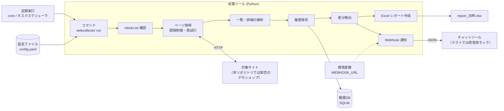

# 基本設計書

## 文書情報

| 項目 | 内容 |
|---|---|
| 文書名 | 基本設計書 |
| 文書ID | BD-001 |
| システム名 | Webデータ収集・定期レポートツール |
| 版 | 1.0 |
| 作成日 | 2026-11-15 |

## 改版履歴

| 版 | 日付 | 変更内容 |
|---|---|---|
| 1.0 | 2026-11-15 | 新規作成 |

## 1. システム構成



| 構成要素 | 役割 | 実装 |
|---|---|---|
| 収集ツール | 収集から通知までを行う | `webcollector/`（Python） |
| 設定ファイル | 収集対象・抽出位置・間隔・通知形式 | `config.example.yaml` を写して使う |
| 履歴DB | 実行・商品・スナップショット・変更の記録 | SQLite（`data/history.db`） |
| デモショップ | 収集の練習台となる架空のショップ | `demo_site/`（Flask。127.0.0.1 でのみ待ち受け） |
| 受信用モック | 通知の送り先の代わり。受け取った JSON を保存する | `tools/mock_webhook.py`（127.0.0.1 でのみ待ち受け） |

## 2. 機能一覧

| 機能ID | 機能名 | 概要 | 対応する要件 | 主なファイル |
|---|---|---|---|---|
| FN-001 | 設定読込 | YAML を読み、必須項目と値の範囲を検査する | REQ-011 | `webcollector/config.py` |
| FN-002 | robots.txt 確認 | サイトごとに robots.txt を取得し、取得可否と Crawl-delay を判定する | REQ-004, REQ-005 | `webcollector/politeness.py` |
| FN-003 | アクセス間隔制御 | 同じサイトへの取得の間隔を保つ | REQ-005 | `webcollector/politeness.py` |
| FN-004 | ページ取得 | User-Agent・タイムアウト・間隔を広げる再試行つきで取得する | REQ-006 | `webcollector/fetcher.py` |
| FN-005 | 一覧・詳細の解析 | CSS セレクタで値を取り出し、価格・在庫を正規化する | REQ-001, REQ-002 | `webcollector/parser.py`、`webcollector/collector.py` |
| FN-006 | JavaScript ページの取得 | 描画後のページを取り出す（Playwright 導入時のみ） | REQ-003 | `webcollector/js_fetcher.py` |
| FN-007 | 履歴保存 | 実行・商品・スナップショットを保存する | REQ-007 | `webcollector/storage.py` |
| FN-008 | 差分検出 | 前回の成功した実行と比べ、6 種類の変更を検出する | REQ-008 | `webcollector/diff.py` |
| FN-009 | Excel レポート出力 | 4 シートの帳票を作る。Web 由来の文字列を無害化する | REQ-009, REQ-013 | `webcollector/report.py`、`webcollector/safe_text.py` |
| FN-010 | Webhook 通知 | 未通知の変更を通知形式に整えて送り、成功したものだけ通知済みにする | REQ-010, REQ-013 | `webcollector/notify.py` |
| FN-011 | コマンド・定期実行 | collect / report / notify / run の各コマンド、終了コード | REQ-012 | `webcollector/cli.py` |

## 3. コマンド

| コマンド | 内容 | 終了コード |
|---|---|---|
| `python -m webcollector collect -c config.yaml` | 収集・保存・差分検出 | 0=成功、1=一部失敗、2=設定エラー |
| `python -m webcollector report -c config.yaml` | Excel レポートを出力 | 0=成功 |
| `python -m webcollector notify -c config.yaml [--dry-run]` | 未通知の変更を送信（`--dry-run` は送らず表示のみ） | 0=成功、1=送信失敗 |
| `python -m webcollector run -c config.yaml` | 上の 3 つを順に実行（定期実行用） | 最も悪い結果 |

## 4. 帳票レイアウト（Excel レポート）

ファイル名は `report_YYYYMMDD_HHMMSS.xlsx`。

| シート | 内容 | 列 |
|---|---|---|
| サマリー | 最新の実行の概要と変更の件数 | 項目、値（実行日時・対象・取得ページ数・取得件数・エラー件数・状態）／変更の種類、件数 |
| 変更一覧 | 直近の実行で検出した変更。種類ごとに行の色を変える | 検出日時、種類、商品ID、商品名、変更前、変更後、差額、URL |
| 最新一覧 | 掲載中の商品の最新の価格と在庫。在庫切れの行は色を変える | 商品ID、商品名、カテゴリ、価格、在庫、最終取得日時、URL |
| 価格推移 | 実行ごとの価格の表と折れ線グラフ（価格が変わった商品のみ。最大 10 商品） | 取得日時、商品ごとの価格 |

変更の種類と色:

| 種類 | 意味 | 行の色 |
|---|---|---|
| 値下げ | 価格が前回より下がった | 緑 |
| 値上げ | 価格が前回より上がった | 橙 |
| 在庫切れ | 在庫ありから在庫切れになった | 赤 |
| 再入荷 | 在庫切れから在庫ありになった | 水色 |
| 新商品 | 前回は無かった商品 | 青 |
| 掲載終了 | 前回はあったが今回は無い商品 | 灰 |

全シートで、商品名など Web から取得した文字列は、先頭が `=` `+` `-` `@` タブ・改行で始まる場合に先頭へ `'` を付けて、数式として実行されないようにする（REQ-013）。

## 5. 通知メッセージのレイアウト

```text
[価格・在庫の変化] demo_shop 2026-11-15 10:00
値下げ 2件 / 在庫切れ 1件 / 新商品 1件
・値下げ A-1001 方眼ノート B5: 480円 → 398円 (-82円)
・在庫切れ A-1003 ゲルインクボールペン 0.5mm 黒: 在庫あり → 在庫切れ
・新商品 A-1013 ...
（ほか n 件は Excel レポートを参照）
```

送信する JSON は設定 `notify.format` で切り替える。

| format | 送る JSON | 備考 |
|---|---|---|
| slack | `{"text": "..."}` | `<` `>` `&` を置き換え、全員宛ての呼び出し記法を無効化 |
| discord | `{"content": "...", "allowed_mentions": {"parse": []}}` | 呼び出しを一切行わない指定 |
| teams | `{"text": "..."}` | |
| generic | `{"text": "...", "events": [...]}` | 自前の受け口向け。変更の明細を構造化して送る |

各サービスの受け口の仕様は変わることがあるため、実サービスへの送信は導入時に確認する（本リポジトリでは未確認）。

## 6. 設定ファイルの主な項目

| 項目 | 意味 | 既定値 |
|---|---|---|
| `user_agent` | 名乗り | `WebDataCollector/1.0 (+https://example.com/bot-info)` |
| `request.interval_sec` | 取得の間隔（秒）。下限 0.5 | 1.0 |
| `request.timeout_sec` | 応答待ちの上限（秒） | 10 |
| `request.max_retries` | 再試行の回数 | 3 |
| `request.backoff_base_sec` | 再試行の待ち時間の基準（秒）。1回目 1 倍、2 回目 2 倍、3 回目 4 倍 | 1.0 |
| `request.max_pages` | 1 対象あたりの取得ページ数の上限 | 50 |
| `targets[]` | 収集対象（名前・種類・開始 URL・セレクタ） | — |
| `notify.format` | 通知形式 | slack |
| `notify.webhook_url_env` | Webhook の URL を入れる環境変数名 | WEBHOOK_URL |
