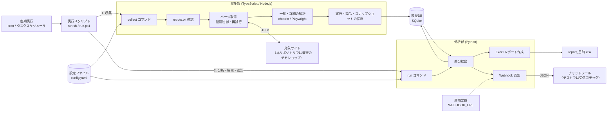

# 基本設計書

## 文書情報

| 項目 | 内容 |
|---|---|
| 文書名 | 基本設計書 |
| 文書ID | BD-001 |
| システム名 | Webデータ収集・定期レポートツール |
| 版 | 1.1 |
| 作成日 | 2026-11-15 |

## 改版履歴

| 版 | 日付 | 変更内容 |
|---|---|---|
| 1.0 | 2026-11-15 | 新規作成 |
| 1.1 | 2026-11-15 | 収集を TypeScript、分析・帳票・通知を Python に分ける構成へ変更。方式設計（2 章）を追加し、機能一覧・コマンド・帳票レイアウトを更新 |

## 1. システム構成



| 構成要素 | 役割 | 実装 |
|---|---|---|
| 収集部 | robots.txt の確認、取得、解析、履歴DB への書き込み | `collector/`（TypeScript・Node.js） |
| 分析部 | 差分検出、Excel レポート、Webhook 通知 | `webcollector/`（Python） |
| 履歴DB | 収集部と分析部の受け渡し口。実行・商品・スナップショット・変更の記録 | SQLite（`data/history.db`）。定義は `sql/schema.sql` の 1 か所 |
| 設定ファイル | 収集対象・抽出位置・間隔・通知形式。両方の部で同じファイルを読む | `config.example.yaml` を写して使う |
| 実行スクリプト | 収集 → 分析の順に実行し、終了コードを返す | `scripts/run.sh`（cron 用）、`scripts/run.ps1`（タスクスケジューラ用） |
| デモショップ | 収集の練習台となる架空のショップ | `demo_site/`（Python / Flask。127.0.0.1 でのみ待ち受け） |
| 受信用モック | 通知の送り先の代わり。受け取った JSON を保存する | `tools/mock_webhook.py`（127.0.0.1 でのみ待ち受け） |

## 2. 方式設計

### 2.1 言語の分担

| 部 | 言語 | 理由 |
|---|---|---|
| 収集 | TypeScript（Node.js） | Web ページを扱う部品（HTML 解析の cheerio、ブラウザ操作の Playwright）が Node.js で最も充実しており、Playwright は本来 Node.js 向けに作られている。通信の待ち（非同期処理）を素直に書ける。型でセレクタ設定の誤りを早めに見つけられる |
| 分析・帳票・通知 | Python | Excel の作成（openpyxl）でグラフ・色分け・書式まで細かく指定できる。集計・比較の処理を短く書け、業務側の担当者が後から直しやすい |
| 定期実行 | シェル / PowerShell | OS 標準の仕組み（cron・タスクスケジューラ）から、2 つの部を順に呼ぶだけの薄い層にする |

詳しい比較は [ADR-0004](adr/0004-言語の分担.md)。

### 2.2 部と部の受け渡し（インターフェース）

2 つの部は**直接呼び合わず、履歴DB（SQLite）だけを介して受け渡す**。定義は `sql/schema.sql` の 1 か所に置き、両方の部が起動時に同じ定義を適用する（項目ごとの説明は [04_テーブル定義書.md](04_テーブル定義書.md)）。

| テーブル | 書き込む部 | 読む部 | 内容 |
|---|---|---|---|
| collection_runs（収集実行） | 収集部（作成・終了）、分析部（分析済みの印 `analyzed_at` のみ） | 分析部 | 1 対象 1 回の収集の記録と状態 |
| products（商品） | 収集部（名前・URL 等）、分析部（掲載中の印 `is_listed` のみ） | 両方 | 商品の基本情報 |
| price_snapshots（スナップショット） | 収集部 | 分析部 | 実行ごとの価格・在庫 |
| change_events（変更） | 分析部 | 分析部 | 差分検出の結果と通知の状態 |

- 分析部は `analyzed_at` が空の実行を古い順に処理する。収集が成功・一部失敗のときだけ差分を出し、失敗・見送りの実行は分析済みの印だけを付ける
- 1 つの列を書き込む部は 1 つに限る（両方が同じ列を書き換えて食い違うことを防ぐ）
- 収集部と分析部は同時に動かさない（実行スクリプトが順番に呼ぶ）

### 2.3 実行環境

| 項目 | 内容 |
|---|---|
| Node.js | 22 系で確認。依存は `collector/node_modules` にのみ入れる。Playwright のブラウザも `PLAYWRIGHT_BROWSERS_PATH=0` で同じ場所に入れる |
| Python | 3.12 で確認。仮想環境（`.venv`）に入れる |
| 通信 | 収集部は対象サイトへ、分析部は Webhook の送り先へだけ通信する |

## 3. 機能一覧

| 機能ID | 機能名 | 概要 | 対応する要件 | 主なファイル |
|---|---|---|---|---|
| FN-001 | 設定読込 | YAML を読み、必須項目と値の範囲を検査する（収集部・分析部それぞれが自分の使う部分を検査） | REQ-011 | `collector/src/config.ts`、`webcollector/config.py` |
| FN-002 | robots.txt 確認 | サイトごとに robots.txt を取得し、取得可否と Crawl-delay を判定する | REQ-004, REQ-005 | `collector/src/politeness.ts` |
| FN-003 | アクセス間隔制御 | 同じサイトへの取得の間隔を保つ | REQ-005 | `collector/src/politeness.ts` |
| FN-004 | ページ取得 | User-Agent・タイムアウト・間隔を広げる再試行つきで取得する | REQ-006 | `collector/src/fetcher.ts` |
| FN-005 | 一覧・詳細の解析 | CSS セレクタで値を取り出し、価格・在庫を正規化する | REQ-001, REQ-002 | `collector/src/parser.ts`、`collector/src/collector.ts` |
| FN-006 | JavaScript ページの取得 | 描画後のページを取り出す（Playwright 導入時のみ） | REQ-003 | `collector/src/jsRenderer.ts` |
| FN-007 | 履歴保存 | 実行・商品・スナップショットを保存する | REQ-007 | `collector/src/storage.ts` |
| FN-008 | 差分検出 | 前回までの記録と比べ、6 種類の変更を検出する | REQ-008 | `webcollector/diff.py`、`webcollector/storage.py` |
| FN-009 | Excel レポート出力 | 4 シートの帳票を作る。Web 由来の文字列を無害化する | REQ-009, REQ-013 | `webcollector/report.py`、`webcollector/safe_text.py` |
| FN-010 | Webhook 通知 | 未通知の変更を通知形式に整えて送り、成功したものだけ通知済みにする | REQ-010, REQ-013 | `webcollector/notify.py` |
| FN-011 | コマンド・定期実行 | 各部のコマンドと終了コード、収集 → 分析を順に呼ぶ実行スクリプト | REQ-012 | `collector/src/cli.ts`、`webcollector/cli.py`、`scripts/run.sh`、`scripts/run.ps1` |

### 3.1 コマンド

| コマンド | 内容 | 終了コード |
|---|---|---|
| `node collector/dist/src/cli.js collect -c config.yaml` | 収集部: 収集して履歴DB に保存 | 0=成功、1=一部失敗・失敗、2=設定エラー |
| `python -m webcollector analyze -c config.yaml` | 分析部: 未分析の実行の差分を検出 | 0=成功、2=設定エラー |
| `python -m webcollector report -c config.yaml` | 分析部: Excel レポートを出力 | 0=成功 |
| `python -m webcollector notify -c config.yaml [--dry-run]` | 分析部: 未通知の変更を送信（`--dry-run` は送らず表示のみ） | 0=成功・送るものなし、1=送信失敗 |
| `python -m webcollector run -c config.yaml` | 分析部: analyze → report → notify を順に実行 | 最も悪い結果 |
| `scripts/run.sh` / `scripts/run.ps1` | 収集部 → 分析部を順に実行（定期実行用） | 最も悪い結果 |

## 4. 帳票レイアウト（Excel レポート）

ファイル名は `report_YYYYMMDD_HHMMSS.xlsx`。

| シート | 内容 | 列 |
|---|---|---|
| サマリー | 対象ごとの最新の実行の概要と変更の件数 | 対象、実行日時、状態、取得ページ数、取得件数、エラー件数、備考／変更の種類、件数 |
| 変更一覧 | 対象ごとの最新の実行で検出した変更。種類ごとに行の色を変える | 検出日時、対象、種類、商品ID、商品名、変更前、変更後、差額、URL |
| 最新一覧 | 掲載中の商品の最新の価格と在庫。在庫切れの行は色を変える | 対象、商品ID、商品名、カテゴリ、価格、在庫、最終取得日時、URL |
| 価格推移 | 対象ごとに、実行ごとの価格の表と折れ線グラフ（価格が変わった商品のみ。1 対象あたり最大 10 商品） | 取得日時、商品ごとの価格 |

変更の種類と色:

| 種類 | 意味 | 行の色 |
|---|---|---|
| 値下げ | 価格が前回より下がった | 緑 |
| 値上げ | 価格が前回より上がった | 橙 |
| 在庫切れ | 在庫ありから在庫切れになった | 赤 |
| 再入荷 | 在庫切れから在庫ありになった | 水色 |
| 新商品 | 前回は無かった商品 | 青 |
| 掲載終了 | 前回はあったが今回は無い商品 | 灰 |

全シートで、商品名など Web から取得した文字列は、先頭が `=` `+` `-` `@` タブ・改行で始まる場合に先頭へ `'` を付けて、数式として実行されないようにする（REQ-013）。URL は文字列として載せ、リンク（ハイパーリンク）にはしない（Web 由来の URL を押させないため）。

## 5. 通知メッセージのレイアウト

```text
[価格・在庫の変化] demo_shop 2026-11-15 10:00
値下げ 2件 / 在庫切れ 1件 / 新商品 1件
・値下げ A-1001 方眼ノート B5: 480円 → 398円 (-82円)
・在庫切れ A-1003 ゲルインクボールペン 0.5mm 黒: 在庫あり → 在庫切れ
・新商品 A-1013 ...
（ほか n 件は Excel レポートを参照）
```

送信する JSON は設定 `notify.format` で切り替える。

| format | 送る JSON | 備考 |
|---|---|---|
| slack | `{"text": "..."}` | `<` `>` `&` を置き換え、全員宛ての呼び出し記法を無効化 |
| discord | `{"content": "...", "allowed_mentions": {"parse": []}}` | 呼び出しを一切行わない指定 |
| teams | `{"text": "..."}` | |
| generic | `{"text": "...", "events": [...]}` | 自前の受け口向け。変更の明細を構造化して送る |

各サービスの受け口の仕様は変わることがあるため、実サービスへの送信は導入時に確認する（本リポジトリでは未確認）。

## 6. 設定ファイルの主な項目

収集部は `user_agent`・`request`・`targets`・`storage`、分析部は `storage`・`report`・`notify`・`log` を読む。

| 項目 | 意味 | 既定値 |
|---|---|---|
| `user_agent` | 名乗り | `WebDataCollector/1.0 (+https://example.com/bot-info)` |
| `request.interval_sec` | 取得の間隔（秒）。下限 0.5 | 1.0 |
| `request.timeout_sec` | 応答待ちの上限（秒） | 10 |
| `request.max_retries` | 再試行の回数 | 3 |
| `request.backoff_base_sec` | 再試行の待ち時間の基準（秒）。1回目 1 倍、2 回目 2 倍、3 回目 4 倍 | 1.0 |
| `request.max_pages` | 1 対象あたりの取得ページ数の上限 | 50 |
| `targets[]` | 収集対象（名前・種類・開始 URL・セレクタ） | — |
| `notify.format` | 通知形式 | slack |
| `notify.webhook_url_env` | Webhook の URL を入れる環境変数名 | WEBHOOK_URL |
