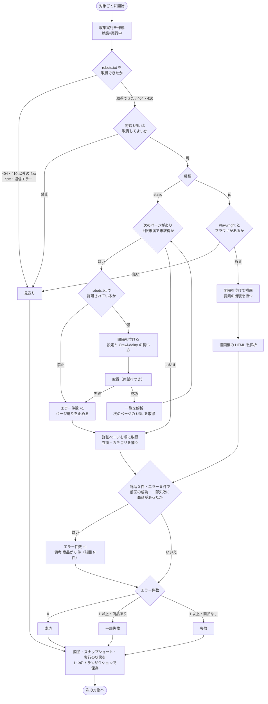
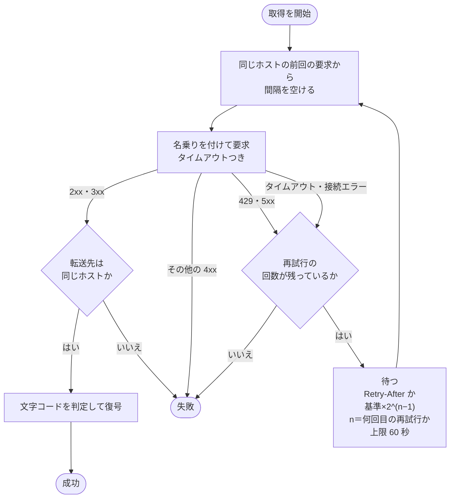
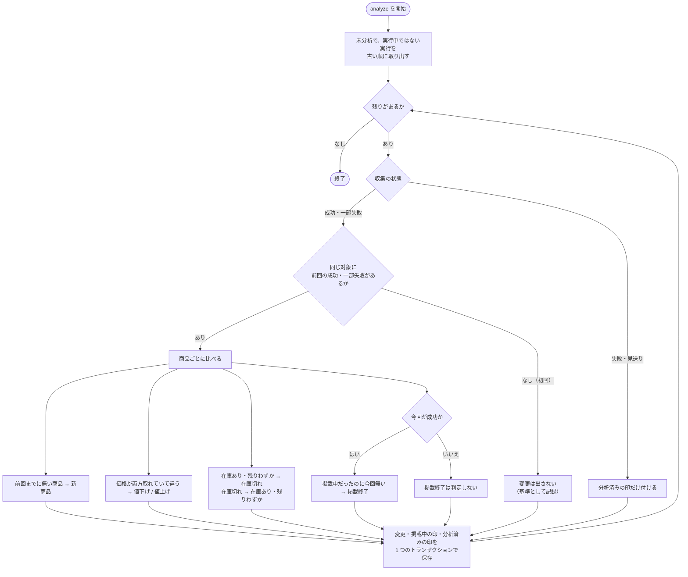
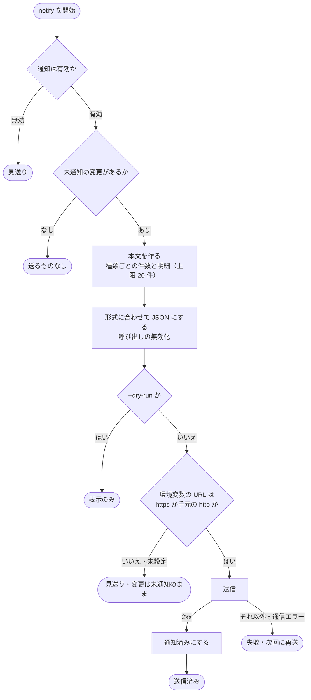

# 詳細設計書

## 文書情報

| 項目 | 内容 |
|---|---|
| 文書名 | 詳細設計書 |
| 文書ID | DD-001 |
| システム名 | Webデータ収集・定期レポートツール |
| 版 | 1.4 |
| 作成日 | 2026-11-15 |

## 改版履歴

| 版 | 日付 | 変更内容 |
|---|---|---|
| 1.0 | 2026-11-15 | 新規作成 |
| 1.1 | 2026-11-16 | 4.1 節「エラー一覧」を追加（例外表と実装の動きからエラーID ERR-001〜ERR-021 を付与） |
| 1.2 | 2026-11-16 | 実装の修正に合わせて更新（ADR-0005）：robots.txt が 404・410 以外の 4xx のときは見送る（1 章の図・E-03・ERR-006）。直前の成功・一部失敗の回に商品があったのに今回 0 件なら「失敗」とする（1 章の図・2 章・E-19・ERR-022 を追加）。分析部で履歴DB を開けない場合も想定外の誤りとして記録する（ERR-019）。E-05・E-15 の記載を実装の動きに合わせて訂正 |
| 1.3 | 2026-11-16 | 文章を見直し（話し言葉・表記ゆれ・説明の不足を修正）。1 章の図の待ち時間の式を実装に合わせて明確化。4.2 節 E-10 の状態を「変えない」に修正（4.1 節 ERR-013 と同じ） |
| 1.4 | 2026-11-16 | ERR-016（E-13）の「無い」を障害対応手順書の見出しと同じ「ない」にそろえた |

## 1. 収集のフロー（収集部・FN-002〜FN-007）

### 1.1 取得（再試行）の詳細

## 2. 差分検出のフロー（分析部・FN-008）

比べる相手は「前回の実行」ではなく「商品ごとに、取れた値のうち最も新しいもの」とする。前回が一部失敗で価格が取れなかった商品でも、その前の値と比べられる。

収集部は、直前の成功・一部失敗の回に商品があったのに今回 1 件も読み取れなかった実行を「失敗」として保存する（E-19）。そのため、セレクタが合わなくなって商品を読み取れない回に、全商品が掲載終了と判定されることはない。商品が 0 件ではなく減っただけの回は「成功」のまま掲載終了を判定する（07_障害対応手順書.md 5.1 節）。

## 3. 通知のフロー（分析部・FN-010）

## 4. 例外表

| No | 発生箇所 | 事象 | 扱い | 実行の状態 | 終了コード |
|---|---|---|---|---|---|
| E-01 | 設定読込（両部） | ファイルが無い・YAML の誤り・必須項目の不足・値の範囲外 | 理由を表示して中止 | 作らない | 2 |
| E-02 | 設定読込（分析部） | `notify.webhook_url` に URL が直接書かれている | 中止（環境変数で渡すよう表示） | 作らない | 2 |
| E-03 | robots.txt | 404・410 以外の 4xx（401・403・再試行後の 429 など）・5xx・通信エラー | その対象を見送る（404・410 は robots.txt が無いものとして制限なしで扱う） | 見送り | 0 |
| E-04 | robots.txt | 開始 URL が禁止 | その対象を見送る | 見送り | 0 |
| E-05 | robots.txt | ページ送りの途中の一覧ページが禁止 | そのページを取得せずエラーとして数え、ページ送りを止める。詳細ページが禁止されている場合はエラーに数えず、その商品の詳細だけを飛ばす | 一部失敗（取れた商品が無ければ失敗） | 1 |
| E-06 | 取得 | 429・5xx・タイムアウト・接続エラー | 待ってから再試行。上限を超えたらエラーとして数える | 一部失敗 / 失敗 | 1 |
| E-07 | 取得 | 404 などの 4xx | 再試行せずエラーとして数える | 一部失敗 / 失敗 | 1 |
| E-08 | 取得 | 別のホストへの転送 | 本文を読まずエラーとして数える | 一部失敗 / 失敗 | 1 |
| E-09 | 一覧 | 取得ページ数の上限に到達 | そこで止めてエラーとして数える（掲載終了の誤報を防ぐ） | 一部失敗 | 1 |
| E-10 | 一覧 | 同じページへ戻るページ送り | そこで止める | 変えない | 0 |
| E-11 | 解析 | 商品ID が取れない行 | その行を飛ばして警告 | 変えない | 0 |
| E-12 | 解析 | 価格・在庫が読めない | 値を空（不明）として保存。差分の比較から外す | 変えない | 0 |
| E-13 | JavaScript ページ | Playwright・ブラウザがない | その対象を見送る | 見送り | 0 |
| E-14 | JavaScript ページ | 描画の失敗・要素が現れない | エラーとして数える | 失敗 | 1 |
| E-15 | 想定外の例外（両部） | DB の誤り（開けない・制約違反など）・帳票の保存の失敗など | 収集部：保存中ならその実行の書き込みを取り消す。その実行は実行中のまま残り、残りの対象はその回は収集しない。分析部：分析中ならその実行の書き込みを取り消して未分析に戻す。`run` では以降の処理（帳票・通知）を行わない | 実行中（収集部）／変えない（分析部） | 1 |
| E-16 | 通知 | URL が未設定・平文の外部 URL | 送らない。変更は未通知のまま | — | 0 |
| E-17 | 通知 | 送信先が 2xx 以外・通信エラー | 送らない。変更は未通知のまま次回に再送 | — | 1 |
| E-18 | 実行スクリプト | 前回の実行が終わっていない | 今回は実行しない | — | 3 |
| E-19 | 解析 | 商品が 0 件（エラー 0 件）で、直前の成功・一部失敗の回に商品があった | エラーとして数える（読み取りの失敗を「成功」として掲載終了の誤報を出さないため。ADR-0005） | 失敗 | 1 |

### 4.1 エラー一覧

運用時に参照するエラーIDを、例外表と実装（`collector/src/`・`webcollector/`・`scripts/run.sh`・`scripts/run.ps1`）の動きから振る。文言は実装が出力するもの（`<>` は実際の値に置き換わる部分）。ログの出力先は 5 章のとおり。終了コードは、その部のコマンドの終了コード（実行スクリプトは収集部と分析部の大きい方を返す）。各エラーの対処は 07_障害対応手順書.md を参照。

| ID | 例外表 | 発生箇所 | 事象 | ログ・画面の文言 | 実行の状態 | 終了コード |
|---|---|---|---|---|---|---|
| ERR-001 | E-01 | 設定読込（収集部） | 設定ファイルが無い・YAML の誤り・必須項目の不足・値の範囲外 | `ERROR [collector] 設定エラー: <理由>`。実行スクリプトは続けて `設定エラーのため中止します`（run.ps1 は `Config error. Stopped.`）を出し、分析部を動かさない | 作らない | 2 |
| ERR-002 | — | コマンド（収集部） | `collect` 以外のコマンド、`--target` に設定に無い対象名を指定 | `使い方: cli.js collect -c config.yaml [--target 名前] [--quiet]`、または `ERROR [collector] 対象が見つかりません: <名前>` | 作らない | 2 |
| ERR-003 | E-01 | 設定読込（分析部） | 設定ファイルが無い・YAML の誤り・notify などの値の誤り | 標準エラーに `設定エラー: <理由>`（`logs/analysis.log` には出ない） | —（実行スクリプトでは収集部の実行は保存済みで、未分析のまま残る） | 2 |
| ERR-004 | E-02 | 設定読込（分析部） | `notify.webhook_url` に URL が直接書かれている | `設定エラー: notify.webhook_url は使えません。URL は環境変数で渡してください（notify.webhook_url_env）` | —（実行スクリプトでは収集部の実行は保存済みで、未分析のまま残る） | 2 |
| ERR-005 | E-18 | 実行スクリプト | 前回の実行が終わっていない（ロックを取れない） | run.sh は `前回の実行が終わっていないため、今回は実行しません`、run.ps1 は `Previous run is still active. Skipped.` | — | 3 |
| ERR-006 | E-03 | robots.txt | robots.txt が 404・410 以外の 4xx（401・403、再試行の上限まで続いた 429 など）・5xx・通信エラー（再試行の上限まで）・別のホストへの転送で取得できない | `WARNING [collector] robots.txt を取得できないため、このサイトの収集を見送ります: <robots.txt の URL> (status=<状態>)`。備考 `robots.txt を取得できないため見送り` | 見送り | 0 |
| ERR-007 | E-04 | robots.txt | 開始 URL が robots.txt で禁止されている | `WARNING [collector] robots.txt で禁止されているため取得しません: <URL>`。備考 `開始 URL が robots.txt で禁止されている` | 見送り | 0 |
| ERR-008 | E-05 | robots.txt | ページ送りの途中の一覧ページが禁止されている（詳細ページが禁止されている場合は数えずに飛ばす） | `WARNING [collector] robots.txt で禁止されているため取得しません: <URL>` | 一部失敗（取れた商品が無ければ失敗） | 1 |
| ERR-009 | E-06 | 取得 | 429・5xx・タイムアウト・接続エラーが再試行の上限まで続いた | 再試行ごとに `WARNING [collector] <理由>。<秒> 秒後に再試行します (<回>/<上限>): <URL>`、最後に `ERROR [collector] 一覧ページを取得できません: 再試行しても取得できません（<理由>）: <URL>`（詳細ページは `詳細ページを取得できません: …`） | 一部失敗 / 失敗 | 1 |
| ERR-010 | E-07 | 取得 | 429 以外の 4xx（404 など） | `ERROR [collector] 一覧ページを取得できません: HTTP <状態>: <URL>`（詳細ページは `詳細ページを取得できません: …`） | 一部失敗 / 失敗 | 1 |
| ERR-011 | E-08 | 取得 | 別のホストへの転送 | `ERROR [collector] 一覧ページを取得できません: 別のホストへ転送されました (<ホスト>): <URL>`（詳細ページは `詳細ページを取得できません: …`） | 一部失敗 / 失敗 | 1 |
| ERR-012 | E-09 | 一覧 | 取得ページ数の上限（`request.max_pages`）に到達 | `WARNING [collector] 取得ページ数の上限 (<上限>) に達したため止めます`。備考 `取得ページ数の上限に達した` | 一部失敗 | 1 |
| ERR-013 | E-10 | 一覧 | 同じページへ戻る、または別のホストへのページ送り | `WARNING [collector] 同じページに戻ったため、ページ送りを止めます: <URL>`、または `WARNING [collector] 別のホストへのリンクはたどりません: <URL>` | 変えない | 0 |
| ERR-014 | E-11 | 解析 | 商品ID が取れない行 | `WARNING [collector] 商品ID が取れない行を飛ばします: <行の値>` | 変えない | 0 |
| ERR-015 | E-12 | 解析 | 価格・在庫が読めない | ログには出さない。帳票の「最新一覧」で価格が空、在庫が「不明」になる | 変えない | 0 |
| ERR-016 | E-13 | JavaScript ページ | Playwright・ブラウザ本体がない | `WARNING [collector] JavaScript ページを見送ります: Playwright が導入されていません（collector で npm install を実行）`、または `…: ブラウザ本体がありません（collector で npm run install-browser を実行）`。備考に同じ理由 | 見送り | 0 |
| ERR-017 | E-14 | JavaScript ページ | 描画の失敗・要素が現れない | `ERROR [collector] JavaScript ページを取得できません: <URL> (<誤りの 1 行目>)` | 失敗 | 1 |
| ERR-018 | E-15 | 収集部（保存を含む） | DB の誤りなどの想定外の例外。保存中の誤りならその実行の書き込みを取り消す。残りの対象は収集しない | `ERROR [collector] 想定外の誤り: <スタックトレース>` | 実行中のまま残る | 1 |
| ERR-019 | E-15 | 分析部（履歴DB を開く処理・分析・帳票・通知） | 履歴DB を開けない・DB の誤り・帳票の保存の失敗などの想定外の例外。分析中ならその実行の書き込みを取り消して未分析に戻す。`run` では以降の処理（帳票・通知）を行わない | `ERROR [analysis] 想定外の誤りで止まりました` とトレースバック（`logs/analysis.log` と標準エラー） | 変えない | 1 |
| ERR-020 | E-16 | 通知 | Webhook の URL が未設定・平文の外部 URL | `WARNING [analysis] 通知を送りません: Webhook の URL が環境変数に設定されていません`、または `…: Webhook の URL は https で指定してください（http は 127.0.0.1 の受け口のみ）`。標準出力に `[通知] skipped: <理由>` | — | 0 |
| ERR-021 | E-17 | 通知 | 送信先が 2xx 以外・通信エラー | `ERROR [analysis] 通知が受け付けられません（次回に再送します）: <伏せた URL> HTTP <状態>`、または `ERROR [analysis] 通知を送れません（次回に再送します）: <伏せた URL> <例外名>`。標準出力に `[通知] failed: <理由>` | — | 1 |
| ERR-022 | E-19 | 解析（収集部） | 一覧ページは取得できたが商品を 1 件も読み取れず、直前の成功・一部失敗の回には商品があった（セレクタが合わなくなったなど） | `ERROR [collector] 商品を 1 件も読み取れません（前回 <件数> 件）。item_selector・fields を確かめてください: <開始 URL>`。備考 `商品が 0 件（前回 <件数> 件）` | 失敗 | 1 |

## 5. ログ方針

| 項目 | 内容 |
|---|---|
| 出力先 | 収集部は標準エラー、分析部は `logs/analysis.log`（1 MB × 5 世代で切替）と標準エラー。実行スクリプトは両方の出力を `logs/run_YYYYMMDD.log` に追記する |
| 書式 | `日時 レベル [collector または analysis] 内容` |
| レベル | INFO=開始・取得件数・通知件数、WARNING=再試行・robots.txt による見送り・項目の取れない行、ERROR=取得の失敗・通知の失敗・想定外の誤り |
| 残さないもの | Webhook の URL のパス・クエリ（`https://ホスト名/***` に伏せる）、商品の説明文、通知の本文 |
| 保存期間 | 実行スクリプトのログは日ごとのファイル。古いものの削除は運用で行う（06_導入・運用手順.md） |
| 履歴DB | 実行ごとの開始・終了・状態・取得ページ数・取得件数・エラー件数・備考を collection_runs に残す（NFR-006） |
