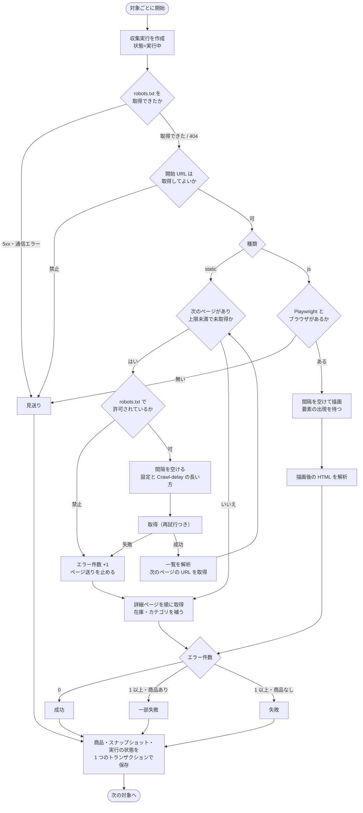
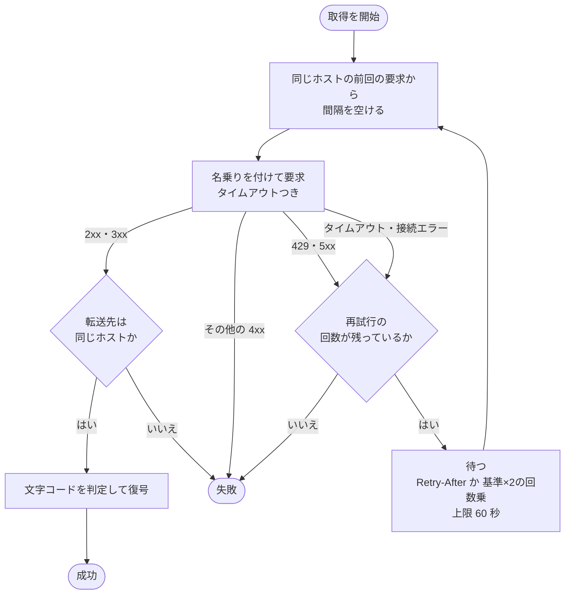

# 詳細設計書

## 文書情報

| 項目 | 内容 |
|---|---|
| 文書名 | 詳細設計書 |
| 文書ID | DD-001 |
| システム名 | Webデータ収集・定期レポートツール |
| 版 | 1.0 |
| 作成日 | 2026-11-15 |

## 改版履歴

| 版 | 日付 | 変更内容 |
|---|---|---|
| 1.0 | 2026-11-15 | 新規作成 |

## 1. 収集のフロー（収集部・FN-002〜FN-007）

### 1.1 取得（再試行）の詳細

## 2. 差分検出のフロー（分析部・FN-008）

比べる相手は「前回の実行」ではなく「商品ごとに、取れた値のうち最も新しいもの」とする。前回が一部失敗で価格が取れなかった商品でも、その前の値と比べられる。

## 3. 通知のフロー（分析部・FN-010）

## 4. 例外表

| No | 発生箇所 | 事象 | 扱い | 実行の状態 | 終了コード |
|---|---|---|---|---|---|
| E-01 | 設定読込（両部） | ファイルが無い・YAML の誤り・必須項目の不足・値の範囲外 | 理由を表示して中止 | 作らない | 2 |
| E-02 | 設定読込（分析部） | `notify.webhook_url` に URL が直接書かれている | 中止（環境変数で渡すよう表示） | 作らない | 2 |
| E-03 | robots.txt | 5xx・通信エラー | その対象を見送る | 見送り | 0 |
| E-04 | robots.txt | 開始 URL が禁止 | その対象を見送る | 見送り | 0 |
| E-05 | robots.txt | 途中のページが禁止 | そのページを取得せずエラーとして数える | 一部失敗 | 1 |
| E-06 | 取得 | 429・5xx・タイムアウト・接続エラー | 待ってから再試行。上限を超えたらエラーとして数える | 一部失敗 / 失敗 | 1 |
| E-07 | 取得 | 404 などの 4xx | 再試行せずエラーとして数える | 一部失敗 / 失敗 | 1 |
| E-08 | 取得 | 別のホストへの転送 | 本文を読まずエラーとして数える | 一部失敗 / 失敗 | 1 |
| E-09 | 一覧 | 取得ページ数の上限に到達 | そこで止めてエラーとして数える（掲載終了の誤報を防ぐ） | 一部失敗 | 1 |
| E-10 | 一覧 | 同じページへ戻るページ送り | そこで止める | 成功 | 0 |
| E-11 | 解析 | 商品ID が取れない行 | その行を飛ばして警告 | 変えない | 0 |
| E-12 | 解析 | 価格・在庫が読めない | 値を空（不明）として保存。差分の比較から外す | 変えない | 0 |
| E-13 | JavaScript ページ | Playwright・ブラウザが無い | その対象を見送る | 見送り | 0 |
| E-14 | JavaScript ページ | 描画の失敗・要素が現れない | エラーとして数える | 失敗 | 1 |
| E-15 | 保存（両部） | 制約違反などの DB の誤り | その実行・分析の書き込みを取り消す（収集部は実行中のまま残り、分析部は触れない） | 実行中 | 1 |
| E-16 | 通知 | URL が未設定・平文の外部 URL | 送らない。変更は未通知のまま | — | 0 |
| E-17 | 通知 | 送信先が 2xx 以外・通信エラー | 送らない。変更は未通知のまま次回に再送 | — | 1 |
| E-18 | 実行スクリプト | 前回の実行が終わっていない | 今回は実行しない | — | 3 |

## 5. ログ方針

| 項目 | 内容 |
|---|---|
| 出力先 | 収集部は標準エラー、分析部は `logs/analysis.log`（1 MB × 5 世代で切替）と標準エラー。実行スクリプトは両方の出力を `logs/run_YYYYMMDD.log` に追記する |
| 書式 | `日時 レベル [collector または analysis] 内容` |
| レベル | INFO=開始・取得件数・通知件数、WARNING=再試行・robots.txt による見送り・項目の取れない行、ERROR=取得の失敗・通知の失敗・想定外の誤り |
| 残さないもの | Webhook の URL のパス・クエリ（`https://ホスト名/***` に伏せる）、商品の説明文、通知の本文 |
| 保存期間 | 実行スクリプトのログは日ごとのファイル。古いものの削除は運用で行う（06_導入・運用手順.md） |
| 履歴DB | 実行ごとの開始・終了・状態・取得ページ数・取得件数・エラー件数・備考を collection_runs に残す（NFR-006） |
