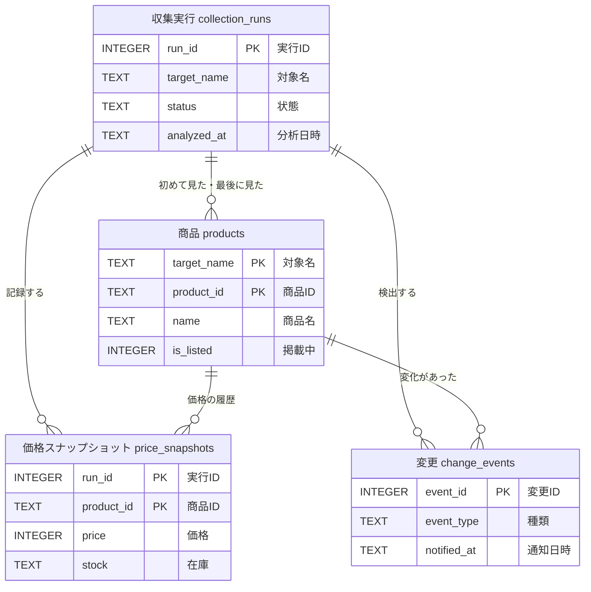

# テーブル定義書

## 文書情報

| 項目 | 内容 |
|---|---|
| 文書名 | テーブル定義書 |
| 文書ID | TD-001 |
| システム名 | Webデータ収集・定期レポートツール |
| 版 | 1.0 |
| 作成日 | 2026-11-15 |

## 改版履歴

| 版 | 日付 | 変更内容 |
|---|---|---|
| 1.0 | 2026-11-15 | 新規作成 |

## 1. 位置づけ

履歴DB（SQLite）は、収集部（TypeScript）と分析部（Python）の**唯一の受け渡し口**である（基本設計書 2.2）。定義の正本は `sql/schema.sql` で、両方の部が起動時に同じファイルを適用する。各列の「書く部」は 1 つに限る。

## 2. テーブル一覧

| 物理名 | 論理名 | 内容 | 行が増える契機 |
|---|---|---|---|
| collection_runs | 収集実行 | 1 対象 1 回の収集の記録と状態 | 収集のたびに対象ごとに 1 行 |
| products | 商品 | 商品の基本情報と掲載中かどうか | 初めて見た商品ごとに 1 行 |
| price_snapshots | 価格スナップショット | 実行ごとの価格・在庫（追記のみ） | 収集のたびに商品ごとに 1 行 |
| change_events | 変更 | 差分検出の結果と通知の状態 | 変更を検出するたびに 1 行 |

## 3. ER 図



ER 図には主な列だけを載せる。全列は 4 章を参照。

## 4. 列の定義

書く部: 収=収集部（collector/src/storage.ts）、分=分析部（webcollector/storage.py）

### 4.1 collection_runs（収集実行）

| 物理名 | 論理名 | 型 | 必須 | 既定値 | 書く部 | 説明 |
|---|---|---|---|---|---|---|
| run_id | 実行ID | INTEGER | ○ | 自動採番 | 収 | 主キー |
| target_name | 対象名 | TEXT | ○ | | 収 | 設定の `targets[].name` |
| started_at | 開始日時 | TEXT | ○ | | 収 | ISO 8601（時差つき） |
| finished_at | 終了日時 | TEXT | | | 収 | 保存の完了時に書く |
| status | 状態 | TEXT | ○ | running | 収 | running（実行中）/ success（成功）/ partial（一部失敗）/ failed（失敗）/ skipped（見送り） |
| pages_fetched | 取得ページ数 | INTEGER | ○ | 0 | 収 | 一覧・詳細・JavaScript ページの合計 |
| items_collected | 取得件数 | INTEGER | ○ | 0 | 収 | 商品の件数 |
| error_count | エラー件数 | INTEGER | ○ | 0 | 収 | 取得できなかったページ数など |
| message | 備考 | TEXT | | | 収 | 見送り・上限到達の理由 |
| analyzed_at | 分析日時 | TEXT | | | 分 | 差分検出を済ませた日時。空なら未分析 |

### 4.2 products（商品）

| 物理名 | 論理名 | 型 | 必須 | 既定値 | 書く部 | 説明 |
|---|---|---|---|---|---|---|
| target_name | 対象名 | TEXT | ○ | | 収 | 主キー（1） |
| product_id | 商品ID | TEXT | ○ | | 収 | 主キー（2）。前回と比べるための鍵 |
| name | 商品名 | TEXT | | | 収 | 取れた場合だけ上書き。最大 200 文字 |
| category | カテゴリ | TEXT | | | 収 | 同上 |
| url | URL | TEXT | | | 収 | 詳細ページの URL |
| first_seen_run_id | 初回の実行ID | INTEGER | ○ | | 収 | collection_runs.run_id。新商品の判定に使う |
| last_seen_run_id | 最終の実行ID | INTEGER | ○ | | 収 | 最後に見つかった実行 |
| is_listed | 掲載中 | INTEGER | ○ | 1 | 分 | 1=掲載中、0=掲載終了。収集部は新しい行を作るときの既定値以外では書かない |

### 4.3 price_snapshots（価格スナップショット）

| 物理名 | 論理名 | 型 | 必須 | 既定値 | 書く部 | 説明 |
|---|---|---|---|---|---|---|
| run_id | 実行ID | INTEGER | ○ | | 収 | 主キー（1）。collection_runs.run_id |
| target_name | 対象名 | TEXT | ○ | | 収 | products への外部キー（1） |
| product_id | 商品ID | TEXT | ○ | | 収 | 主キー（2）。products への外部キー（2） |
| price | 価格 | INTEGER | | | 収 | 円。取れなかった場合は空。0 以上 |
| stock | 在庫 | TEXT | | | 収 | in_stock（在庫あり）/ low_stock（残りわずか）/ out_of_stock（在庫切れ）/ unknown（不明）。取れなかった場合は空 |
| collected_at | 取得日時 | TEXT | ○ | | 収 | ISO 8601（時差つき） |

### 4.4 change_events（変更）

| 物理名 | 論理名 | 型 | 必須 | 既定値 | 書く部 | 説明 |
|---|---|---|---|---|---|---|
| event_id | 変更ID | INTEGER | ○ | 自動採番 | 分 | 主キー |
| run_id | 実行ID | INTEGER | ○ | | 分 | 変更を検出した実行 |
| target_name | 対象名 | TEXT | ○ | | 分 | products への外部キー（1） |
| product_id | 商品ID | TEXT | ○ | | 分 | products への外部キー（2） |
| event_type | 種類 | TEXT | ○ | | 分 | price_down（値下げ）/ price_up（値上げ）/ out_of_stock（在庫切れ）/ restock（再入荷）/ new（新商品）/ delisted（掲載終了） |
| old_value | 変更前 | TEXT | | | 分 | 表示用の文字列（例: 480円、在庫あり） |
| new_value | 変更後 | TEXT | | | 分 | 同上 |
| price_diff | 差額 | INTEGER | | | 分 | 値下げ・値上げのときだけ。円 |
| detected_at | 検出日時 | TEXT | ○ | | 分 | 収集の終了日時 |
| notified_at | 通知日時 | TEXT | | | 分 | 送信に成功した日時。空なら未通知（次回に再送） |

## 5. 索引

| 名前 | テーブル | 列 | 用途 |
|---|---|---|---|
| idx_runs_target | collection_runs | target_name, status, run_id | 前回の成功した実行を探す |
| idx_snapshots_product | price_snapshots | target_name, product_id, run_id | 商品ごとの直近の値・価格推移 |
| idx_events_unnotified | change_events | notified_at, event_id | 未通知の変更を探す |

## 6. DDL（sql/schema.sql）

```sql
-- 履歴DB（SQLite）の定義。収集部（collector/src/storage.ts）と分析部（webcollector/storage.py）の受け渡し口。
-- 両方の部が起動時に実行する（CREATE ... IF NOT EXISTS のため何度実行してもよい）。
-- 論理名・項目の説明は docs/04_テーブル定義書.md を参照。

PRAGMA foreign_keys = ON;

-- 収集実行
CREATE TABLE IF NOT EXISTS collection_runs (
    run_id          INTEGER PRIMARY KEY AUTOINCREMENT,
    target_name     TEXT    NOT NULL,
    started_at      TEXT    NOT NULL,
    finished_at     TEXT,
    status          TEXT    NOT NULL DEFAULT 'running'
                    CHECK (status IN ('running', 'success', 'partial', 'failed', 'skipped')),
    pages_fetched   INTEGER NOT NULL DEFAULT 0,
    items_collected INTEGER NOT NULL DEFAULT 0,
    error_count     INTEGER NOT NULL DEFAULT 0,
    message         TEXT,
    analyzed_at     TEXT
);
CREATE INDEX IF NOT EXISTS idx_runs_target ON collection_runs (target_name, status, run_id);

-- 商品
CREATE TABLE IF NOT EXISTS products (
    target_name       TEXT    NOT NULL,
    product_id        TEXT    NOT NULL,
    name              TEXT,
    category          TEXT,
    url               TEXT,
    first_seen_run_id INTEGER NOT NULL REFERENCES collection_runs (run_id),
    last_seen_run_id  INTEGER NOT NULL REFERENCES collection_runs (run_id),
    is_listed         INTEGER NOT NULL DEFAULT 1 CHECK (is_listed IN (0, 1)),
    PRIMARY KEY (target_name, product_id)
);

-- 価格・在庫のスナップショット（実行ごとに追記し、上書きしない）
CREATE TABLE IF NOT EXISTS price_snapshots (
    run_id       INTEGER NOT NULL REFERENCES collection_runs (run_id),
    target_name  TEXT    NOT NULL,
    product_id   TEXT    NOT NULL,
    price        INTEGER CHECK (price IS NULL OR price >= 0),
    stock        TEXT    CHECK (stock IS NULL OR stock IN ('in_stock', 'low_stock', 'out_of_stock', 'unknown')),
    collected_at TEXT    NOT NULL,
    PRIMARY KEY (run_id, product_id),
    FOREIGN KEY (target_name, product_id) REFERENCES products (target_name, product_id)
);
CREATE INDEX IF NOT EXISTS idx_snapshots_product ON price_snapshots (target_name, product_id, run_id);

-- 変更（差分検出の結果と通知の状態）
CREATE TABLE IF NOT EXISTS change_events (
    event_id    INTEGER PRIMARY KEY AUTOINCREMENT,
    run_id      INTEGER NOT NULL REFERENCES collection_runs (run_id),
    target_name TEXT    NOT NULL,
    product_id  TEXT    NOT NULL,
    event_type  TEXT    NOT NULL
                CHECK (event_type IN ('price_down', 'price_up', 'out_of_stock', 'restock', 'new', 'delisted')),
    old_value   TEXT,
    new_value   TEXT,
    price_diff  INTEGER,
    detected_at TEXT    NOT NULL,
    notified_at TEXT,
    FOREIGN KEY (target_name, product_id) REFERENCES products (target_name, product_id)
);
CREATE INDEX IF NOT EXISTS idx_events_unnotified ON change_events (notified_at, event_id);
```
