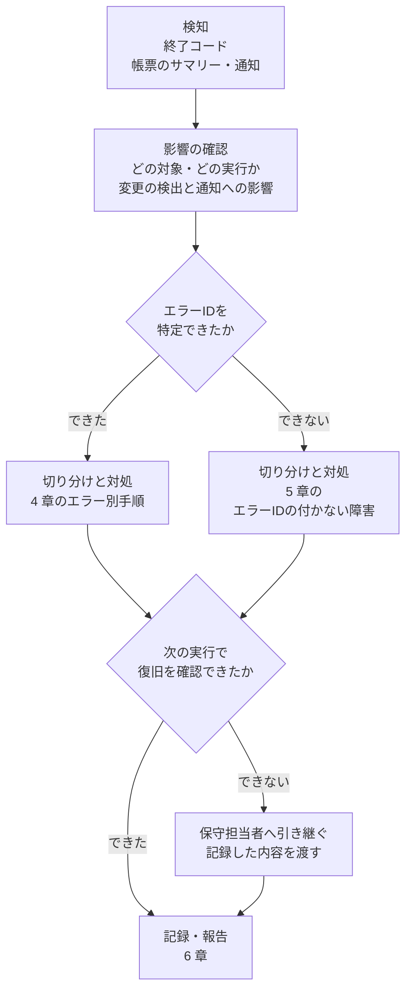

# 障害対応手順書

## 文書情報

| 項目 | 内容 |
|---|---|
| 文書名 | 障害対応手順書 |
| 文書ID | OP-INC-001 |
| システム名 | Webデータ収集・定期レポートツール |
| 版 | 1.1 |
| 作成日 | 2026-11-16 |
| 状態 | 承認済 |

## 改版履歴

| 版 | 日付 | 変更内容 |
|---|---|---|
| 1.0 | 2026-11-16 | 新規作成 |
| 1.1 | 2026-11-16 | 実装の修正に合わせて更新：ERR-006 に 404・410 以外の 4xx を追加。ERR-022（前回は商品があったのに 0 件）を追加し、5.1 節を「0 件ではなく減った場合」に改めた。ERR-019 から「履歴DB を開くところではトレースバックだけ」の記載を削除（修正済み）。3.3 節・4.14 節・7 章を更新 |

## 1. 目的と対象

### 1.1 目的

定期実行の終了コード・帳票の状態・ログに異常が出たとき、通知が届かないときに、切り分けから復旧の確認・記録までを同じ手順で行えるようにする。エラーID（詳細設計書 4.1 節のエラー一覧）ごとに、確かめることと対処、再実行してよいかを示す。

### 1.2 使う人と使う場面

| 使う人 | 使う場面 |
|---|---|
| 運用担当者 | 実行スクリプトの終了コードが 0 以外のとき。帳票の「サマリー」で状態が「成功」以外の対象があるとき。通知が届かない・急に大量に届いたとき |
| 保守担当者 | 運用担当者の対処で解消しないとき。想定外の誤り（ERR-018・ERR-019）が出たとき。対象サイトの作りの変更でセレクタを直すとき |

### 1.3 対象と対象外

| 区分 | 範囲 |
|---|---|
| 対象 | 実行スクリプト（`scripts/run.sh`・`scripts/run.ps1`）、収集部（`collector/`）、分析部（`webcollector/`）、履歴DB（`data/history.db`）、帳票（`output/`）、ログ（`logs/`） |
| 対象外 | 対象サイト・通知先のチャットサービス自体の障害、cron・タスクスケジューラ・OS の障害の調査（5 章で確かめる点だけを示す）、架空のデモショップ（`demo_site/`）と受信用モック（試験用の部品） |

### 1.4 障害対応でも守ること（対象サイトへの配慮）

このツールは、対象サイトの取り決め（robots.txt）を守り、負担をかけないことを最優先にしている（要件定義書 NFR-001・NFR-002、ADR-0003）。障害を早く解消するためであっても、次のことは行わない。

- robots.txt で禁止されたページを取得するように設定やコードを変えること。robots.txt を取得できないときに見送る動き（ERR-006）を止めること
- 名乗り（`user_agent`）を他のブラウザなどに偽ること、問い合わせ先を消すこと
- 取得の間隔（`request.interval_sec`）を短くすること、再試行の回数（`request.max_retries`）を増やして混雑しているサイトに要求を重ねること
- 見送り・失敗のたびに、手動で何度も収集をやり直すこと（収集のやり直しは、原因を直した後に 1 回だけ行う）

対象サイトから停止の依頼があった場合、403・429 が続く場合は、ただちに設定ファイルの `targets` から外し、利用規約を確かめ直す（06_導入・運用手順.md 1 章）。

## 2. 障害時の基本の流れ



| 段階 | 行うこと |
|---|---|
| 検知 | 実行スクリプトの終了コード、`logs/run_YYYYMMDD.log`、帳票の「サマリー」の状態、通知の有無で気付く |
| 影響の確認 | どの対象のどの実行か、その実行で変更の検出（特に掲載終了）と通知が正しく行われたかを確かめる |
| 切り分け | 3 章の順に確かめ、エラーIDを特定する |
| 対処 | 4 章（エラーIDあり）または 5 章（エラーIDなし）の手順で行う。1.4 節に反する対処はしない |
| 復旧の確認 | 次の定期実行（または原因を直した後の 1 回の実行）で、終了コード 0・状態「成功」・通知の送信済みを確かめる |
| 記録・報告 | 6 章の項目で記録し、報告する |

## 3. 切り分けの順番

### 3.1 終了コード

実行スクリプトは、収集部と分析部の終了コードの大きい方を返す（収集部が 2 のときは分析部を動かさずに 2 を返す）。

| 終了コード | 意味 | 次に見るもの |
|---|---|---|
| 0 | すべて成功。ただし「見送り」（ERR-006・ERR-007・ERR-016）と通知の見送り（ERR-020）も 0 になる | 3.3 の帳票の状態、3.2 の WARNING の行 |
| 1 | 収集の一部失敗・失敗、通知の送信失敗、想定外の誤り | 3.2 の ERROR の行 |
| 2 | 設定・コマンドの誤り（ERR-001〜ERR-004） | 3.2 の「設定エラー」の行 |
| 3 | 前回の実行が終わっていない（ERR-005） | 4.5 節 |
| 上記以外（127 など） | Node.js・Python が見つからないなど、各部が動く前の失敗 | 5 章 |

### 3.2 実行スクリプトのログ

`logs/run_YYYYMMDD.log`（実行した日のファイル）に、収集部・分析部の出力がすべて追記される。分析部の設定エラー（ERR-003・ERR-004）はここにしか残らない。

```bash
# 実行ごとの開始・終了と、各部の終了コード
grep -n '=====' logs/run_YYYYMMDD.log
# 対象ごとの結果（状態・取得ページ・商品・エラー件数・備考）
grep -n '^\[収集\]\|^\[分析\]\|^\[帳票\]\|^\[通知\]' logs/run_YYYYMMDD.log
# 誤り・警告の行
grep -nE 'ERROR|WARNING|設定エラー|前回の実行|中止します' logs/run_YYYYMMDD.log
```

ログの書式は `日時 レベル [collector または analysis] 内容`。収集部の行は `[collector]`、分析部の行は `[analysis]` が付く。Webhook の URL は `https://ホスト名/***` に伏せて記録する（詳細設計書 5 章）。

### 3.3 帳票の「サマリー」

`output/report_YYYYMMDD_HHMMSS.xlsx` の「サマリー」に、対象ごとの最新の実行の状態・取得ページ数・取得件数・エラー件数・備考が載る。

| 状態 | 意味 | 該当するエラーID |
|---|---|---|
| 成功 | すべてのページを取得できた。取得件数が前回より大きく減っていないかも見る（5.1 節） | ERR-013〜ERR-015 は成功のまま起こる |
| 一部失敗 | 一部のページを取得できなかった。掲載終了は判定しない | ERR-008〜ERR-012 |
| 失敗 | 1 件も取得できなかった。前回は商品があったのに 1 件も読み取れなかった場合も含む。掲載終了は判定しない | ERR-008〜ERR-012、ERR-017、ERR-022 |
| 見送り | robots.txt・Playwright の都合で収集しなかった。備考に理由が入る | ERR-006・ERR-007・ERR-016 |
| 実行中 | 収集部が途中で止まり、結果を保存できなかった | ERR-018、5.6 節 |

### 3.4 分析部のログ

`logs/analysis.log`（1 MB ごとに切り替え、5 世代まで残す）。想定外の誤り（ERR-019）のトレースバックはここに残る。

```bash
grep -nE 'ERROR|WARNING' logs/analysis.log | tail -n 20
```

### 3.5 履歴DB

実行ごとの記録（collection_runs）と、未通知の変更（change_events）を確かめる。`sqlite3` コマンドが無い場合は、Python 3.12 に含まれる `python -m sqlite3` を使う（1 回に 1 つの SQL）。

```bash
# 直近の実行（状態・件数・備考・分析済みか）
.venv/bin/python -m sqlite3 data/history.db "SELECT run_id, target_name, started_at, status, pages_fetched, items_collected, error_count, message, analyzed_at FROM collection_runs ORDER BY run_id DESC LIMIT 10"
# 未通知の変更の件数（通知の失敗・見送りで残っているもの）
.venv/bin/python -m sqlite3 data/history.db "SELECT target_name, event_type, COUNT(*) FROM change_events WHERE notified_at IS NULL GROUP BY target_name, event_type"
```

履歴DB を開くのは、定期実行が動いていない時間に行う。読むだけで、書き換えない。

## 4. エラー別の対応手順

すべてのエラーで共通すること：

- **収集のやり直しは対象サイトへの要求を増やす。** 原因を直した後に 1 回だけ行い、それ以外は次の定期実行を待つ（1.4 節）
- 収集をやり直しても、変更が二重に検出されることはない（新しい実行は、商品ごとに直前に取れた値と比べる。詳細設計書 2 章）
- 分析（`analyze`）は未分析の実行だけを処理するため、何度実行してもよい。帳票（`report`）は実行のたびに日時の入った新しいファイルを作る
- 通知（`notify`）は未通知の変更だけを送り、送信先が 2xx を返したものだけを通知済みにする。送信先が受け取ったのに応答が届かなかった場合（タイムアウトなど）は、次回にもう一度送られ、同じ内容が二重に届く

### 4.1 ERR-001 収集部の設定エラー

| 項目 | 内容 |
|---|---|
| 事象 | 終了コード 2。ログに `ERROR [collector] 設定エラー: <理由>` と、実行スクリプトの `設定エラーのため中止します`（run.ps1 は `Config error. Stopped.`） |
| 影響 | その回は収集・分析・帳票・通知をすべて行わない。履歴DB には何も書かないため、データは壊れない。変更の検出が 1 回分遅れる |
| 想定原因 | 設定ファイルが無い（`設定ファイルが見つかりません`）、YAML の書き方の誤り、`targets` の必須項目（`name`・`start_url`・`item_selector`・`fields.product_id`）の不足、対象名の重複、`request.interval_sec` が下限（0.5 秒）未満などの値の範囲外 |
| 確認すること | ログの `<理由>` の文言。`git diff` などで設定ファイルの直近の変更 |
| 対処 | 理由に従って `config.yaml` を直す。直した後に `node collector/dist/src/cli.js collect -c config.yaml --target <対象名>` で 1 対象だけ動かして確かめる（06_導入・運用手順.md 4 章） |
| 復旧の確認 | 次の実行で `設定エラー` の行が出ず、終了コードが 2 以外になる |
| 再実行してよいか | よい。設定を直す前に何度実行しても何も書かれない。直した後の実行は収集を行うため、1 回だけにする |
| 関連 | FN-001、FN-011、TC-001-01、TC-001-02 |

### 4.2 ERR-002 収集部のコマンドの指定誤り

| 項目 | 内容 |
|---|---|
| 事象 | 終了コード 2。`使い方: cli.js collect -c config.yaml [--target 名前] [--quiet]`、または `ERROR [collector] 対象が見つかりません: <名前>` |
| 影響 | 収集しない。データは壊れない。実行スクリプトは `collect -c <設定>` だけを渡すため、手動で収集部を動かしたときにだけ起こる |
| 想定原因 | `collect` の綴りの誤り、`--target` に設定ファイルの `targets[].name` に無い名前を指定 |
| 確認すること | 打ったコマンドと、設定ファイルの `targets[].name` |
| 対処 | コマンドを直して実行する |
| 復旧の確認 | `[収集] <対象名>: <状態> …` の行が出る |
| 再実行してよいか | よい。指定を直した後の実行は収集を行うため、1 回だけにする |
| 関連 | FN-011、試験なし |

### 4.3 ERR-003 分析部の設定エラー

| 項目 | 内容 |
|---|---|
| 事象 | 終了コード 2。標準エラー（実行スクリプトのログ）に `設定エラー: <理由>`。`logs/analysis.log` には出ない |
| 影響 | 分析・帳票・通知を行わない。実行スクリプトから動かした場合、収集部は先に動き、その回の収集結果は保存済みで未分析のまま残る（次に分析部が動いたときに古い順に分析される。TC-008-08）。データは壊れない |
| 想定原因 | 収集部が検査しない項目の誤り：`notify.format` が slack・discord・teams・generic 以外、`notify.max_items` が 1 未満、`notify.timeout_sec` が 1 未満、`storage`・`report`・`log`・`notify` の書き方の誤り。設定ファイルが無い・YAML の誤り（この場合は通常、先に収集部が ERR-001 で止まる） |
| 確認すること | `<理由>` の文言。`.venv/bin/python -m webcollector analyze -c config.yaml` で同じエラーが出るか |
| 対処 | 理由に従って `config.yaml` を直し、`.venv/bin/python -m webcollector run -c config.yaml` で分析・帳票・通知だけを動かす（収集はやり直さない） |
| 復旧の確認 | `[分析] 実行 <番号> (<対象名>, <状態>): …` と `[帳票] … を出力しました` が出る |
| 再実行してよいか | よい。分析部だけの実行は対象サイトに要求を送らない。未分析の実行は 1 回だけ分析される |
| 関連 | FN-001、FN-011、TC-001-04、TC-001-05、TC-011-03 |

### 4.4 ERR-004 Webhook の URL が設定ファイルに書かれている

| 項目 | 内容 |
|---|---|
| 事象 | 終了コード 2。`設定エラー: notify.webhook_url は使えません。URL は環境変数で渡してください（notify.webhook_url_env）` |
| 影響 | 分析・帳票・通知を行わない（収集結果は保存済みで未分析のまま残る）。**URL が設定ファイルに書かれているため、設定ファイルを共有・保存した先に URL が漏れている可能性がある** |
| 想定原因 | `notify` の下に `webhook_url:` を書いた |
| 確認すること | `config.yaml` の `notify` の項目。設定ファイルをリポジトリ・共有フォルダ・メールなどに置いていないか |
| 対処 | `webhook_url:` の行を消し、URL は環境変数（既定は `WEBHOOK_URL`）で渡す（06_導入・運用手順.md 3.3 節）。設定ファイルを他の場所に置いていた場合は、URL が漏れたものとして通知先で Webhook を発行し直し、古い URL を無効にする（06_導入・運用手順.md 11 章）。その後、分析部だけを動かす |
| 復旧の確認 | `設定エラー` が出ず、`[通知] sent: <件数> 件を送信` または `[通知] nothing: 未通知の変更はありません` が出る |
| 再実行してよいか | よい（ERR-003 と同じ） |
| 関連 | FN-001、TC-001-04 |

### 4.5 ERR-005 前回の実行が終わっていない

| 項目 | 内容 |
|---|---|
| 事象 | 終了コード 3。ログに `前回の実行が終わっていないため、今回は実行しません`（run.ps1 は `Previous run is still active. Skipped.`） |
| 影響 | その回は何もしない。履歴DB を収集部と分析部が同時に書かないための動きで、データは壊れない |
| 想定原因 | 前回の実行がまだ動いている（対象・ページ数が多い、応答の遅いサイトで再試行・タイムアウトが重なった）。手動の実行と定期実行が重なった |
| 確認すること | `pgrep -af 'cli.js collect\|webcollector'` で前回の処理が残っているか。前回の `logs/run_YYYYMMDD.log` に `===== 終了` の行があるか。ロックは処理が終わると自動で外れるため、`logs/.run.lock` のファイルが残っていること自体は原因ではない |
| 対処 | 前回の処理が動いていれば終わるのを待つ。毎回重なる場合は、実行の間隔を空けるか、`targets` の数・`request.max_pages` を見直す（間隔 `request.interval_sec` は短くしない。1.4 節）。処理が止まって見えても、強制終了は最後の手段とする（収集中に止めると、その実行は「実行中」のまま残る。5.6 節） |
| 復旧の確認 | 次の実行で `===== 開始` と `===== 終了` の行が出る |
| 再実行してよいか | 前回の処理が終わった後ならよい。終わる前に実行しても、終了コード 3 で何もせずに終わる |
| 関連 | FN-011、試験なし |

### 4.6 ERR-006 robots.txt を取得できないため見送り

| 項目 | 内容 |
|---|---|
| 事象 | 終了コード 0。状態「見送り」、備考 `robots.txt を取得できないため見送り`。ログに `WARNING [collector] robots.txt を取得できないため、このサイトの収集を見送ります: <robots.txt の URL> (status=<状態>)` |
| 影響 | その対象はその回は収集しない。分析では見送りの実行に分析済みの印だけを付け、変更は出さない。データは壊れない。続くと変更の検出が止まる |
| 想定原因 | 対象サイトの一時的な障害（5xx）、通信の障害・タイムアウト（再試行の上限まで続いた）、robots.txt が別のホストへ転送される。robots.txt が 404・410 以外の 4xx（401・403 でアクセスを断られている、再試行しても 429 が続いた など。404・410 は「robots.txt が無い」として制限なしで収集する） |
| 確認すること | ログの `status=` の値（`null` は通信エラー・タイムアウト・別のホストへの転送。401・403・429 は対象サイトがアクセスを断っている可能性がある）。同じ時刻に他の対象も見送りになっていないか（自分の側の通信の障害か）。ブラウザで robots.txt を 1 回だけ開いて表示されるか |
| 対処 | 取り決めを確かめられないときは収集しない設計のため、見送りのまま次の定期実行を待つ。見送りの動きを止めたり、手動で何度も収集したりしない（1.4 節）。`status=` が 401・403・429 のときは、対象サイトがこのツールのアクセスを断っている可能性があるため 5.5 節に従う。何日も続く場合は運用担当者が対象サイトの状況を確かめ、収集を続けるか `targets` から外すかを決める |
| 復旧の確認 | 次の実行で `robots.txt を確認しました`（404・410 のときは `robots.txt がありません`）の行が出て、状態が「見送り」以外になる |
| 再実行してよいか | 原因（自分の側の通信の障害など）を直した後に 1 回だけならよい。データの副作用はないが、対象サイトへの要求が増える。401・403・429 のときは再実行しない |
| 関連 | FN-002、TC-002-04、TC-002-06、TC-002-07、ADR-0005 |

### 4.7 ERR-007 開始 URL が robots.txt で禁止されているため見送り

| 項目 | 内容 |
|---|---|
| 事象 | 終了コード 0。状態「見送り」、備考 `開始 URL が robots.txt で禁止されている`。ログに `WARNING [collector] robots.txt で禁止されているため取得しません: <URL>` |
| 影響 | その対象は robots.txt 以外を一切取得しない。データは壊れない。robots.txt が変わらない限り、毎回見送りになる |
| 想定原因 | 対象サイトが robots.txt を変え、そのページ、またはこのツールの名乗り（`user_agent` の `/` より前の部分）を禁止した。`start_url` の書き誤り |
| 確認すること | ブラウザで robots.txt を開き、`User-agent: *` と `User-agent: WebDataCollector`（名乗りの名前）の `Disallow` に開始 URL が含まれるか |
| 対処 | 禁止されている場合はその対象の収集をやめ、`targets` から外す（06_導入・運用手順.md 1 章）。名乗りを変えて禁止を避けることはしない。`start_url` の書き誤りなら直す |
| 復旧の確認 | `targets` から外した場合は、次の帳票にその対象の新しい実行が出ないこと。書き誤りを直した場合は、状態が「見送り」以外になること |
| 再実行してよいか | 禁止されている間は、何度実行しても見送りになる（robots.txt を 1 回取得するだけ）。書き誤りを直した後に 1 回だけならよい |
| 関連 | FN-002、TC-002-05 |

### 4.8 ERR-008 途中のページが robots.txt で禁止されている

| 項目 | 内容 |
|---|---|
| 事象 | 終了コード 1。状態「一部失敗」（取れた商品が無ければ「失敗」）。ログに `WARNING [collector] robots.txt で禁止されているため取得しません: <URL>` |
| 影響 | 禁止された一覧ページから先のページ送りを止める。一部失敗の回は掲載終了を判定しないため、誤った掲載終了の通知は出ない。ただし毎回続くと、掲載終了が検出されなくなる。詳細ページが禁止されている場合は、エラーに数えずにその商品の詳細だけを飛ばす（在庫・カテゴリが空のまま） |
| 想定原因 | ページ送りのリンクが、robots.txt で禁止された場所（並べ替え・絞り込みの URL など）を指している。対象サイトが robots.txt を変えた |
| 確認すること | ログの禁止された URL と、robots.txt の `Disallow` |
| 対処 | 禁止された URL を取得しない。禁止されていない一覧ページだけをたどるように `start_url`・`next_page` を見直す。見直せない場合は一部失敗のまま運用するか、`targets` から外すかを運用担当者が決める |
| 復旧の確認 | 次の実行で状態が「成功」になり、禁止の WARNING が出ない |
| 再実行してよいか | 設定を見直した後に 1 回だけならよい。見直す前は同じ結果になる |
| 関連 | FN-002、FN-005、試験なし |

### 4.9 ERR-009 再試行しても取得できない

| 項目 | 内容 |
|---|---|
| 事象 | 終了コード 1。状態「一部失敗」または「失敗」。ログに再試行ごとの `WARNING [collector] <理由>。<秒> 秒後に再試行します (<回>/<上限>): <URL>` と、最後に `ERROR [collector] 一覧ページを取得できません: 再試行しても取得できません（<理由>）: <URL>`（詳細ページなら `詳細ページを取得できません: …`）。理由は `一時的な誤り (HTTP 503)`・`タイムアウト`・`接続できません (<コード>)` など |
| 影響 | 一覧ページで起きた場合はそこでページ送りを止め、詳細ページで起きた場合はその商品の在庫・カテゴリを空のまま残して次へ進む。一部失敗・失敗の回は掲載終了を判定しないため、誤報は出ない。取れた商品の価格・在庫の変化は検出される。データは壊れない |
| 想定原因 | 対象サイトの混雑・一時的な障害（429・5xx）、応答の遅れ（`request.timeout_sec` を超えた）、自分の側の通信の障害 |
| 確認すること | ログの理由と、その対象・時刻だけか（他の対象も同時に失敗していれば自分の側）。429 が続く場合は、対象サイトが要求の多さを嫌っている可能性 |
| 対処 | 一時的なものは次の定期実行で自動的に回復する（TC-E2E-02）。応答が常に遅いサイトは `request.timeout_sec` を延ばしてよい。429 が続く場合は収集の頻度を下げる（cron の時刻を減らす）。再試行の回数を増やす・間隔を短くすることはしない（1.4 節） |
| 復旧の確認 | 次の実行で状態が「成功」になり、ERROR の行が出ない |
| 再実行してよいか | 自分の側の障害を直した後に 1 回だけならよい。相手側の混雑が原因のときは、すぐにやり直さず次の定期実行を待つ |
| 関連 | FN-004、TC-004-03、TC-004-06、TC-004-07、TC-E2E-02 |

### 4.10 ERR-010 取得できない（4xx）

| 項目 | 内容 |
|---|---|
| 事象 | 終了コード 1。状態「一部失敗」または「失敗」。ログに `ERROR [collector] 一覧ページを取得できません: HTTP <状態>: <URL>`（詳細ページなら `詳細ページを取得できません: …`）。再試行はしない |
| 影響 | ERR-009 と同じ（一覧ページならページ送りを止め、詳細ページなら値を空のまま残す。掲載終了は判定しない）。データは壊れない |
| 想定原因 | 404：ページの URL が変わった・削除された（詳細ページなら商品の掲載終了の可能性）。403：アクセスを拒否されている。401：ログインが必要なページ |
| 確認すること | ログの状態の数字と URL。その URL をブラウザで 1 回だけ開いて確かめる |
| 対処 | 404 の一覧ページは `start_url`・`next_page` を直す。詳細ページの 404 が一部の商品だけなら、次の実行で一覧から消えれば掲載終了として検出されるため、対処は不要。403 が続く場合は対象サイトに拒否されているものとして収集をやめ、利用規約を確かめ直す（1.4 節）。401 のページはログインが必要なため収集の対象にしない（06_導入・運用手順.md 1 章） |
| 復旧の確認 | 次の実行で状態が「成功」になる |
| 再実行してよいか | 設定を直した後に 1 回だけならよい。403・401 のときはやり直さない |
| 関連 | FN-004、FN-005、TC-004-05、TC-005-07 |

### 4.11 ERR-011 別のホストへ転送された

| 項目 | 内容 |
|---|---|
| 事象 | 終了コード 1。状態「一部失敗」または「失敗」。ログに `ERROR [collector] 一覧ページを取得できません: 別のホストへ転送されました (<ホスト>): <URL>`（詳細ページなら `詳細ページを取得できません: …`） |
| 影響 | 転送先の本文は読まない。ERR-009 と同じく、掲載終了は判定しない。データは壊れない |
| 想定原因 | 対象サイトのドメインの移転、ログイン画面・別サービスへの転送、`http` から `https` の別ホストへの転送 |
| 確認すること | ログの転送先のホスト。ブラウザで元の URL を開き、どこに転送されるか |
| 対処 | 同じ運営者のドメイン移転であれば、移転先について 06_導入・運用手順.md 1 章の確認（利用規約・robots.txt）をやり直してから `start_url` を書き換える。ログイン画面への転送であれば収集の対象にしない |
| 復旧の確認 | 次の実行で状態が「成功」になる |
| 再実行してよいか | 確認と設定の変更の後に 1 回だけならよい |
| 関連 | FN-004、TC-004-08 |

### 4.12 ERR-012 取得ページ数の上限に到達

| 項目 | 内容 |
|---|---|
| 事象 | 終了コード 1。状態「一部失敗」、備考 `取得ページ数の上限に達した`。ログに `WARNING [collector] 取得ページ数の上限 (<上限>) に達したため止めます` |
| 影響 | 上限より先の一覧ページを取得しない。掲載終了は判定しない（取れなかった商品を掲載終了と誤報しないため）。データは壊れない。毎回続くと掲載終了が検出されなくなる |
| 想定原因 | 対象サイトの商品が増えて一覧のページ数が上限（`request.max_pages`、既定 50）を超えた。ページ送りの指定（`next_page`）が想定外のリンク（無限に続くカレンダーなど）を拾っている |
| 確認すること | ログの「一覧 <URL> から <件数> 件」の行で、どの URL をたどったか。対象サイトの一覧の実際のページ数 |
| 対処 | 商品が増えただけなら、対象サイトの負担を考えたうえで `request.max_pages` を必要な分だけ上げる。想定外のリンクを拾っている場合は `next_page` を直す。`start_url` を絞り込んだ一覧にする方法もある |
| 復旧の確認 | 次の実行で状態が「成功」になり、備考が空になる |
| 再実行してよいか | 設定を直した後に 1 回だけならよい |
| 関連 | FN-005、TC-005-05 |

### 4.13 ERR-013 ページ送りを途中で止めた

| 項目 | 内容 |
|---|---|
| 事象 | 終了コード・状態は変わらない（他に誤りがなければ「成功」）。ログに `WARNING [collector] 同じページに戻ったため、ページ送りを止めます: <URL>`、または `WARNING [collector] 別のホストへのリンクはたどりません: <URL>` |
| 影響 | 最後のページで「次へ」が先頭や同じページを指しているサイトでは、通常の動き。データは壊れない。ただし途中で止まって取得件数が減った場合は、状態が「成功」のまま取れなかった商品が掲載終了になる（5.1 節） |
| 想定原因 | 最後のページの「次へ」のリンクが自分自身・先頭のページを指している。ページ送りのリンクが別のホストを指している |
| 確認すること | 取得件数が前回と比べて大きく減っていないか（3.5 節の SQL の `items_collected`） |
| 対処 | 取得件数が変わっていなければ不要。減っている場合は `next_page` のセレクタを直す（5.1 節） |
| 復旧の確認 | 取得件数が対象サイトの商品数と合う |
| 再実行してよいか | よい。設定を直した後に 1 回だけにする |
| 関連 | FN-005、TC-005-06 |

### 4.14 ERR-014 商品ID が取れない行

| 項目 | 内容 |
|---|---|
| 事象 | 終了コード・状態は変わらない。ログに `WARNING [collector] 商品ID が取れない行を飛ばします: <行の値>` |
| 影響 | その行は保存しない。商品ID は前回と比べる鍵のため、取れない行が多いと取得件数が減り、状態が「成功」のまま掲載終了が大量に出ることがある（5.1 節）。すべての行で取れず 0 件になった場合は、前回に商品があれば「失敗」になり掲載終了は判定しない（ERR-022） |
| 想定原因 | 対象サイトの作りが変わり、`fields.product_id` のセレクタ・属性が合わなくなった。広告などの商品でない要素が `item_selector` に含まれている |
| 確認すること | WARNING の件数と、`<行の値>` に商品名・価格が入っているか（入っていれば商品ID だけが取れていない） |
| 対処 | ブラウザの開発者ツールで商品ID の位置を調べ、`fields.product_id` を直す（06_導入・運用手順.md 4 章）。商品でない要素だけなら対処不要 |
| 復旧の確認 | `--target` で 1 対象だけ動かし、WARNING が出ず取得件数が戻る |
| 再実行してよいか | セレクタを直した後に 1 回だけならよい |
| 関連 | FN-005、試験なし |

### 4.15 ERR-015 価格・在庫が読めない

| 項目 | 内容 |
|---|---|
| 事象 | ログには出ない。帳票の「最新一覧」で価格が空、在庫が「不明」になる |
| 影響 | 取れなかった値は保存するが比べない（値下げ・在庫切れなどを誤って出さない）。商品ごとに直前に取れた値が比べる相手として残るため、直せば正しく比べられる。データは壊れない。続くと価格・在庫の変化が検出されない |
| 想定原因 | `fields.price` のセレクタが価格以外の文字（「会員価格」など）を含む、価格の表記が想定と違う。在庫の表記が `stock_words` に無い |
| 確認すること | 帳票の「最新一覧」で空・不明の商品の数。ブラウザで商品ページの価格・在庫の表記 |
| 対処 | `fields.price` が価格だけを指すように直す。在庫の表記は `stock_words` に追記する（06_導入・運用手順.md 4 章） |
| 復旧の確認 | 次の帳票の「最新一覧」で価格・在庫が入る |
| 再実行してよいか | 設定を直した後に 1 回だけならよい |
| 関連 | FN-005、FN-008、TC-005-01、TC-005-07、TC-008-04 |

### 4.16 ERR-016 Playwright・ブラウザが無いため見送り

| 項目 | 内容 |
|---|---|
| 事象 | 終了コード 0。種類が `js` の対象の状態が「見送り」。ログに `WARNING [collector] JavaScript ページを見送ります: Playwright が導入されていません（collector で npm install を実行）`、または `…: ブラウザ本体がありません（collector で npm run install-browser を実行）` |
| 影響 | その対象は収集しない。データは壊れない |
| 想定原因 | `npm ci` を `--omit=optional` などで行い Playwright が入っていない。`npm run install-browser` を行っていない。`collector/node_modules` を消して入れ直した |
| 確認すること | `ls collector/node_modules/playwright` と、ブラウザ本体の有無 |
| 対処 | `cd collector && npm ci && npm run install-browser`（06_導入・運用手順.md 3 章） |
| 復旧の確認 | 次の実行で `JavaScript ページ <URL> から <件数> 件` の行が出る |
| 再実行してよいか | 導入した後に 1 回だけならよい |
| 関連 | FN-006、TC-006-02 |

### 4.17 ERR-017 JavaScript ページを取得できない

| 項目 | 内容 |
|---|---|
| 事象 | 終了コード 1。状態「失敗」。ログに `ERROR [collector] JavaScript ページを取得できません: <URL> (<誤りの 1 行目>)` |
| 影響 | その対象はその回の商品が 0 件。失敗の回は変更を出さないため、誤報は出ない。データは壊れない |
| 想定原因 | `wait_for` の要素が `request.timeout_sec` 以内に現れない（対象サイトの作りの変更・描画の遅れ）。ページを開けない。ブラウザの起動の失敗 |
| 確認すること | `<誤りの 1 行目>`（タイムアウトか、ページを開けないか）。ブラウザで開き、`wait_for` の要素があるか |
| 対処 | 要素が変わった場合は `wait_for`・`item_selector`・`fields` を直す。描画が遅いだけなら `request.timeout_sec` を延ばす |
| 復旧の確認 | 次の実行で状態が「成功」になる |
| 再実行してよいか | 設定を直した後に 1 回だけならよい |
| 関連 | FN-006、試験なし |

### 4.18 ERR-018 収集部の想定外の誤り

| 項目 | 内容 |
|---|---|
| 事象 | 終了コード 1。ログに `ERROR [collector] 想定外の誤り: <スタックトレース>`。それより後の対象の `[収集]` の行が出ない。その対象の状態が「実行中」のまま残る |
| 影響 | 保存の途中で起きた場合は、その実行の書き込み（商品・スナップショット）をすべて取り消す（TC-007-04）。残りの対象はその回は収集しない。「実行中」のまま残った実行は、分析の対象にも、次回以降の比べる相手にもならないため、変更の誤報は出ない。データは壊れない。実行スクリプトは続けて分析部を動かす |
| 想定原因 | 履歴DB の誤り（ディスクの空き不足、他の処理が履歴DB を開いている、ファイルの権限、`sql/schema.sql` の誤り）、プログラムの不具合 |
| 確認すること | スタックトレースの 1 行目（例外の種類とメッセージ）。`df -h` でディスクの空き。`ls -l data/history.db` で権限。履歴DB を開いている別の処理がないか |
| 対処 | 原因（空き不足・権限など）を直し、次の定期実行を待つか、1 回だけ実行し直す。「実行中」のまま残った行は消さなくてよい。不具合が疑われる場合は、スタックトレースを添えて保守担当者へ連絡する |
| 復旧の確認 | 次の実行で全対象の `[収集]` の行が出て、`想定外の誤り` が出ない |
| 再実行してよいか | 原因を直した後に 1 回だけならよい。直す前は同じ誤りで止まる |
| 関連 | FN-007、FN-011、TC-007-04 |

### 4.19 ERR-019 分析部の想定外の誤り

| 項目 | 内容 |
|---|---|
| 事象 | 終了コード 1。`logs/analysis.log` と標準エラーに `ERROR [analysis] 想定外の誤りで止まりました` とトレースバック。`run` では、止まった処理より後（帳票・通知）が行われない。履歴DB を開けない場合も同じ行が出る |
| 影響 | 分析中に起きた場合は、その実行の分析の書き込みを取り消して未分析に戻す（TC-008-13）。次に分析部が動いたときに古い順に分析し直す。帳票の保存で起きた場合は、分析の結果は保存済みで、通知はその回は送らない（未通知のまま次回に送る）。データは壊れない |
| 想定原因 | 履歴DB の誤り（ディスクの空き不足・権限・他の処理が開いている・`storage.db_path` の親がフォルダとして作れない）、帳票の出力先（`output/`）に書けない、プログラムの不具合 |
| 確認すること | トレースバックの最後の行（例外の種類とメッセージ）。`df -h`、`ls -ld output data` |
| 対処 | 原因を直し、`.venv/bin/python -m webcollector run -c config.yaml` で分析部だけを動かす（収集はやり直さない）。不具合が疑われる場合は、トレースバックを添えて保守担当者へ連絡する |
| 復旧の確認 | `[分析]`・`[帳票]`・`[通知]` の行が出て、終了コードが 0 になる |
| 再実行してよいか | よい。分析部だけの実行は対象サイトに要求を送らず、分析は未分析の実行だけを処理する。通知は未通知の変更だけを送る |
| 関連 | FN-008、FN-009、FN-010、FN-011、TC-008-13、TC-011-06 |

### 4.20 ERR-020 Webhook の URL が未設定・使えないため通知を見送り

| 項目 | 内容 |
|---|---|
| 事象 | 終了コード 0。通知が届かない。ログに `WARNING [analysis] 通知を送りません: Webhook の URL が環境変数に設定されていません`、または `…: Webhook の URL は https で指定してください（http は 127.0.0.1 の受け口のみ）`。標準出力に `[通知] skipped: <理由>` |
| 影響 | 変更は未通知のまま残り、URL を設定した後の実行でまとめて送られる。データは壊れない。帳票は作られる |
| 想定原因 | cron・タスクスケジューラから動かすときに環境変数が渡っていない（cron で URL を書いたファイルを読み込んでいない、タスクを実行する利用者の環境変数に設定していない）。URL が `http://` の外部の宛先。`notify.webhook_url_env` の名前と環境変数の名前が違う |
| 確認すること | 定期実行と同じ方法で URL を書いたファイルを読み込んだ端末で、`printenv WEBHOOK_URL > /dev/null && echo 設定あり` が「設定あり」を出すか（値は表示しない。`--dry-run` は URL を使わないため、この確認にはならない）。環境変数の名前が `notify.webhook_url_env`（既定 `WEBHOOK_URL`）と同じか。なお `[通知] skipped: 通知は無効（notify.enabled: false）` は設定どおりの動きで、障害ではない |
| 対処 | 環境変数を設定する（06_導入・運用手順.md 3.3 節）。URL は https のものにする。設定した後、`.venv/bin/python -m webcollector notify -c config.yaml` で溜まっている変更を送る |
| 復旧の確認 | `[通知] sent: <件数> 件を送信` が出て、通知先に届く |
| 再実行してよいか | よい。未通知の変更だけを送り、送信できたものだけを通知済みにする |
| 関連 | FN-010、TC-010-04、TC-010-08 |

### 4.21 ERR-021 通知の送信に失敗

| 項目 | 内容 |
|---|---|
| 事象 | 終了コード 1。通知が届かない。ログに `ERROR [analysis] 通知が受け付けられません（次回に再送します）: <伏せた URL> HTTP <状態>`、または `ERROR [analysis] 通知を送れません（次回に再送します）: <伏せた URL> <例外名>`。標準出力に `[通知] failed: <理由>` |
| 影響 | 変更は未通知のまま残り、次の実行で他の変更とまとめて送られる（明細は 1 通に `notify.max_items` 件まで。残りは件数だけを示し、帳票を参照させる）。収集結果・帳票は保存済みで、データは壊れない。**`<例外名>` がタイムアウトなどで、送信先が実際には受け取っていた場合は、次回に同じ内容がもう一度届く** |
| 想定原因 | 4xx：Webhook の URL が無効になった・誤っている（発行し直した、チャンネルを消した）、送信先の受け口の形式の変更。5xx・通信エラー：通知先のサービスの一時的な障害、自分の側の通信の障害 |
| 確認すること | ログの HTTP の状態・例外名。通知先のサービスの稼働状況。Webhook が通知先の管理画面で有効か |
| 対処 | 一時的なものは次の実行で自動的に再送される。4xx が続く場合は、通知先で Webhook を発行し直し、環境変数を書いたファイルを更新する（06_導入・運用手順.md 11 章）。その後、`.venv/bin/python -m webcollector notify -c config.yaml` で送る |
| 復旧の確認 | `[通知] sent: <件数> 件を送信` が出て、通知先に届く。3.5 節の SQL で未通知の変更が 0 件になる |
| 再実行してよいか | よい。ただし直前の失敗がタイムアウト・通信エラーのときは、通知先に既に届いていないかを確かめてから送る（二重に届くことがある） |
| 関連 | FN-010、FN-011、TC-010-07、TC-011-02 |

### 4.22 ERR-022 前回は商品があったのに 1 件も読み取れない

| 項目 | 内容 |
|---|---|
| 事象 | 終了コード 1。状態「失敗」、備考 `商品が 0 件（前回 <件数> 件）`。ログに `ERROR [collector] 商品を 1 件も読み取れません（前回 <件数> 件）。item_selector・fields を確かめてください: <開始 URL>` |
| 影響 | 一覧ページは取得できたが、商品を 1 件も読み取れなかった。失敗の回は変更を出さないため、掲載終了の誤報は出ない。データは壊れない。続く間は、その対象の変更（値下げ・在庫切れなど）が検出されない |
| 想定原因 | 対象サイトの作りが変わり、`item_selector`・`fields.product_id` が合わなくなった。一覧ページの代わりにお知らせ・メンテナンス中の画面が返っている。対象サイトの商品が本当に 0 件になった |
| 確認すること | ブラウザで開始 URL を 1 回だけ開き、商品が掲載されているか。掲載されていれば、開発者ツールで商品の要素が `item_selector` に合うか。3.5 節の SQL で `items_collected` の推移 |
| 対処 | セレクタが合わない場合は `item_selector`・`fields` を直す（06_導入・運用手順.md 4 章）。メンテナンス中なら次の定期実行を待つ。商品が本当に 0 件になった場合は、このままでは毎回「失敗」になり掲載終了も記録されないため、運用担当者が収集を続けるか `targets` から外すかを決める |
| 復旧の確認 | `--target` で 1 対象だけ動かし、状態が「成功」になり取得件数が前回並みに戻る |
| 再実行してよいか | セレクタを直した後に 1 回だけならよい。直す前は同じ結果になる |
| 関連 | FN-005、FN-007、FN-008、TC-005-09、TC-005-10、TC-007-06、ADR-0005 |

## 5. エラーIDの付かない障害

### 5.1 取得件数が急に減ったのに状態が「成功」（対象サイトの作りの変更）

| 項目 | 内容 |
|---|---|
| 事象 | 帳票の「サマリー」で状態は「成功」だが、取得件数が前回より大きく減っている。続けて、掲載終了の通知が大量に届く。初回から、または前回も 0 件だった対象で取得件数が 0 件のまま |
| 影響 | 一部の商品だけ読み取れなくなった場合（ページ送りのセレクタが途中で合わない、一部の行で商品ID が取れない）は、エラーにならず「成功」になる。成功の回は掲載終了を判定するため、読み取れなかった商品が掲載終了として記録・通知される。セレクタを直した次の実行で、それらの商品は掲載中に戻る（新商品としては出ない）が、記録された掲載終了の変更は履歴に残る。前回は商品があったのに 1 件も読み取れなかった場合は「失敗」になり、掲載終了は判定しない（ERR-022）。初回から 0 件の対象は比べる相手が無いため「成功」のままになる |
| 確認すること | 3.5 節の SQL で `items_collected` の推移。ブラウザで一覧ページを開き、商品が掲載されているか |
| 対処 | ブラウザの開発者ツールで、`item_selector`・`fields` を直す（06_導入・運用手順.md 4 章）。通知を受けた人に、その回の掲載終了は誤りであることを伝える |
| 再実行してよいか | セレクタを直した後に、`--target` で 1 対象だけ 1 回動かして取得件数を確かめる |

### 5.2 定期実行が動いていない

| 項目 | 内容 |
|---|---|
| 事象 | その日の `logs/run_YYYYMMDD.log` が無い、または `===== 開始` の行が増えていない。帳票が新しく作られない |
| 確認すること | `crontab -l` に登録があるか（Windows はタスクスケジューラの履歴）。`scripts/cron.example` の形で登録している場合、URL を書いたファイル（`. <ファイル> &&` の部分）が無い・読めないと、実行スクリプトそのものが動かない |
| 対処 | 登録と、読み込むファイルの場所・権限を直す。手で `scripts/run.sh config.yaml` を 1 回動かして確かめる |

### 5.3 Node.js・Python・依存の部品が無い

| 項目 | 内容 |
|---|---|
| 事象 | 終了コードが 0〜3 以外（127 など）、または `===== 終了 (収集=<コード>, 分析=<コード>) =====` の値が 0〜3 以外。ログに「見つからない」旨の OS・シェルの表示。`collector/dist` が無いと Node.js がモジュールを見つけられない旨を出す |
| 確認すること | `node --version`（22 以上）、`.venv/bin/python --version`（3.12 以上）、`ls collector/dist/src/cli.js`。cron からの実行では PATH が対話の端末と違うことがある（`NODE_BIN`・`PYTHON_BIN` で場所を指定できる） |
| 対処 | 06_導入・運用手順.md 3 章の手順で導入し直す（`npm ci`・`npm run build`・`pip install -r requirements.txt`） |

### 5.4 ディスクの空き不足

| 項目 | 内容 |
|---|---|
| 事象 | ERR-018・ERR-019 の想定外の誤り、ログ・帳票が書かれない |
| 確認すること | `df -h`、`du -sh data output logs` |
| 対処 | 古いログ・帳票を削除する（06_導入・運用手順.md 7 章）。履歴DB は消さない（消すと前回との比較ができなくなる） |

### 5.5 対象サイトからの停止の依頼・アクセスの拒否

| 項目 | 内容 |
|---|---|
| 事象 | 対象サイトの管理者からの連絡（名乗りの問い合わせ先に届く）。403・429 が毎回続く |
| 対処 | ただちに設定ファイルの `targets` から外し、運用担当者が利用規約と収集の必要性を確かめ直す。名乗り・間隔を変えて続けることはしない（1.4 節） |

### 5.6 処理を途中で止めた（強制終了・PC の停止）

| 項目 | 内容 |
|---|---|
| 事象 | 帳票の「サマリー」で状態が「実行中」のまま |
| 影響 | 収集の途中で止めた実行は「実行中」のまま残る。分析の対象にも比べる相手にもならないため、変更の誤報は出ない。分析の途中で止めた場合は、その実行の分析は取り消されて未分析に戻る |
| 対処 | 次の定期実行を待つ。「実行中」の行は消さなくてよい（次の実行が成功すると、帳票にはその実行が載る） |

### 5.7 通知先の受け口の仕様の変更

| 項目 | 内容 |
|---|---|
| 事象 | ERR-021 で 4xx が毎回続く。または送信は成功するが、通知先での表示が崩れる |
| 確認すること | 通知先のサービスの Webhook の案内と、`notify --dry-run` で表示される JSON。Slack・Teams・Discord の実際のサービスへの送信は試験していない（05_テスト仕様書.md 6 章） |
| 対処 | 保守担当者が `webcollector/notify.py` の形式を見直す。直すまでの間は帳票の「変更一覧」で確認する |

## 6. 障害の記録と報告

### 6.1 記録する項目

| 項目 | 書く内容 |
|---|---|
| 発生日時 | 実行の開始日時（`===== 開始` の行）と、気付いた日時 |
| 検知方法 | 終了コード／帳票のサマリー／通知が届かない／掲載終了が大量に届いた／対象サイトからの連絡 など |
| エラーID | 4 章のID。付かない場合は 5 章の見出し |
| 影響範囲 | 対象名・実行の番号（run_id）、見送り・失敗した回数、誤って通知した変更・届かなかった通知の有無 |
| 原因 | 確定した原因。確定していなければ「調査中」と、分かっていること |
| 対処 | 行った操作（設定の変更・導入し直し・分析部だけの実行 など）と、収集をやり直した回数 |
| 再発防止 | セレクタの見直し、実行の時刻の変更、手順書への追記 など。不要なら「なし」と理由 |

記録には Webhook の URL（伏せる前のもの）、環境変数を書いたファイルの中身を書き写さない。

### 6.2 報告のひな形

```markdown
## 障害報告：Webデータ収集・定期レポートツール

- 発生日時：YYYY-MM-DD HH:MM（実行の開始）
- 検知方法：
- エラーID：ERR-xxx（障害名）
- 影響範囲：
  - 対象・実行：（対象名・run_id・状態）
  - 変更の検出・通知への影響：（誤った通知の有無、届かなかった通知の件数）
- 原因：
- 対処：
  - 収集をやり直した回数：
- 復旧の確認：（次の実行の終了コード・状態・通知の結果）
- 再発防止：
- 報告者（役割）：運用担当者／保守担当者
```

## 7. エラーID対応表

詳細設計書（03_詳細設計.md）4.1 節のすべてのエラーIDを載せる。

| エラーID | 意味 | 発生する機能 | 節 | 関連テスト |
|---|---|---|---|---|
| ERR-001 | 収集部の設定エラー（終了コード 2） | FN-001、FN-011 | [4.1](#41-err-001-収集部の設定エラー) | TC-001-01、TC-001-02 |
| ERR-002 | 収集部のコマンドの指定誤り（終了コード 2） | FN-011 | [4.2](#42-err-002-収集部のコマンドの指定誤り) | 試験なし |
| ERR-003 | 分析部の設定エラー（終了コード 2） | FN-001、FN-011 | [4.3](#43-err-003-分析部の設定エラー) | TC-001-04、TC-001-05、TC-011-03 |
| ERR-004 | Webhook の URL の直接記載（終了コード 2） | FN-001 | [4.4](#44-err-004-webhook-の-url-が設定ファイルに書かれている) | TC-001-04 |
| ERR-005 | 前回の実行が終わっていない（終了コード 3） | FN-011 | [4.5](#45-err-005-前回の実行が終わっていない) | 試験なし |
| ERR-006 | robots.txt を取得できず見送り | FN-002 | [4.6](#46-err-006-robotstxt-を取得できないため見送り) | TC-002-04、TC-002-06、TC-002-07 |
| ERR-007 | 開始 URL が robots.txt で禁止され見送り | FN-002 | [4.7](#47-err-007-開始-url-が-robotstxt-で禁止されているため見送り) | TC-002-05 |
| ERR-008 | 途中のページが robots.txt で禁止 | FN-002、FN-005 | [4.8](#48-err-008-途中のページが-robotstxt-で禁止されている) | 試験なし |
| ERR-009 | 再試行しても取得できない | FN-004 | [4.9](#49-err-009-再試行しても取得できない) | TC-004-03、TC-004-06、TC-004-07、TC-E2E-02 |
| ERR-010 | 4xx で取得できない | FN-004、FN-005 | [4.10](#410-err-010-取得できない4xx) | TC-004-05、TC-005-07 |
| ERR-011 | 別のホストへの転送 | FN-004 | [4.11](#411-err-011-別のホストへ転送された) | TC-004-08 |
| ERR-012 | 取得ページ数の上限に到達 | FN-005 | [4.12](#412-err-012-取得ページ数の上限に到達) | TC-005-05 |
| ERR-013 | ページ送りを途中で止めた | FN-005 | [4.13](#413-err-013-ページ送りを途中で止めた) | TC-005-06 |
| ERR-014 | 商品ID が取れない行 | FN-005 | [4.14](#414-err-014-商品id-が取れない行) | 試験なし |
| ERR-015 | 価格・在庫が読めない | FN-005、FN-008 | [4.15](#415-err-015-価格在庫が読めない) | TC-005-01、TC-005-07、TC-008-04 |
| ERR-016 | Playwright・ブラウザが無く見送り | FN-006 | [4.16](#416-err-016-playwrightブラウザが無いため見送り) | TC-006-02 |
| ERR-017 | JavaScript ページを取得できない | FN-006 | [4.17](#417-err-017-javascript-ページを取得できない) | 試験なし |
| ERR-018 | 収集部の想定外の誤り | FN-007、FN-011 | [4.18](#418-err-018-収集部の想定外の誤り) | TC-007-04 |
| ERR-019 | 分析部の想定外の誤り | FN-008〜FN-011 | [4.19](#419-err-019-分析部の想定外の誤り) | TC-008-13、TC-011-06 |
| ERR-020 | Webhook の URL が未設定・使えず通知を見送り | FN-010 | [4.20](#420-err-020-webhook-の-url-が未設定使えないため通知を見送り) | TC-010-04、TC-010-08 |
| ERR-021 | 通知の送信に失敗 | FN-010、FN-011 | [4.21](#421-err-021-通知の送信に失敗) | TC-010-07、TC-011-02 |
| ERR-022 | 前回は商品があったのに 1 件も読み取れない | FN-005、FN-007、FN-008 | [4.22](#422-err-022-前回は商品があったのに-1-件も読み取れない) | TC-005-09、TC-005-10、TC-007-06 |

この表と 4 章の見出しが詳細設計書のエラー一覧と一致していることは、自動テスト `tests/test_docs_trace.py`（TC-DOC-01）で確かめる。
